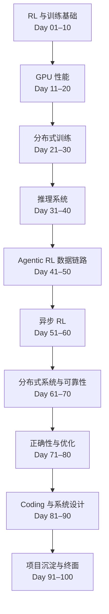

# 100 天课程总纲

## 课程目标

课程面向准备 RL Infrastructure、Distributed Training Systems、Training Systems 和 Research Engineer 面试的工程师。完成课程后，应能解释一条 RL 训练链路，推导常用目标函数，定位数据、数值、通信和调度问题，并把工程经验讲成有证据的设计决策。

课程不假定学习者能随时回忆所有基础知识。每个主题先补必要概念，再进入数学、实现和系统权衡。已有实战经验用于构造例子，不作为跳过基础的理由。

## 学习路径

## 十个模块

| 模块 | 天数 | 学习重点 | 阶段产出 |
|---|---:|---|---|
| RL 与训练基础 | 01–10 | 数据契约、Transformer/Autograd、Policy Gradient、GAE、PPO、GRPO、Rollout/Learner 循环 | 最小 PPO/GRPO 训练步 |
| GPU 性能 | 11–20 | Roofline、GEMM、Attention、Triton、FP8、Profiler | 可复现性能报告 |
| 分布式训练 | 21–30 | DDP、FSDP、TP、PP、EP、CP、NCCL | 8–64 GPU 并行设计 |
| 推理系统 | 31–40 | Prefill/Decode、KV Cache、调度、投机解码 | 推理吞吐基准 |
| Agentic RL 数据链路 | 41–50 | Trajectory、Reward、工具调用、DataSampler、TransferQueue | 可测试的 DataSampler |
| 异步 RL | 51–60 | Partial Rollout、Staleness、权重同步、恢复 | 同步/异步对照实验 |
| 分布式系统与可靠性 | 61–70 | Ray、K8s、状态恢复、可观测性、故障注入 | 千卡级系统设计 |
| 正确性与优化 | 71–80 | 确定性、Logprob Drift、混精、OPD、成本 | 端到端验证清单 |
| Coding 与系统设计 | 81–90 | 并发、调度、网络、容量规划 | 现场编码与设计演练 |
| 项目沉淀与终面 | 91–100 | 项目陈述、代码审查、模拟面试 | 可公开作品集与能力差距报告 |

## 前十天：从概念走到最小系统

| Day | 主题 | 在主线中的作用 |
|---|---|---|
| 01 | RL 端到端数据流与不变量 | 定义 Trajectory、身份关联和版本语义 |
| 02 | Transformer 前向、反向与显存 | 解释训练时的计算图和内存账本 |
| 03 | Autograd、AdamW 与梯度累积 | 建立可验证的参数更新过程 |
| 04 | Policy Gradient 与 Logprob | 把离散动作、Reward 和可微梯度连接起来 |
| 05 | Value、TD Error 与 GAE | 从回报估计走向 Advantage |
| 06 | PPO Ratio、Clip 与 KL | 理解策略更新幅度的约束 |
| 07 | GRPO / DAPO 的组内 Advantage | 理解同一 Prompt 多条轨迹如何比较 |
| 08 | 最小 Rollout Loop | 将 Prompt、生成、Reward、Mask 和组数据连成可运行循环 |
| 09 | 最小 Learner Loop | 将 Logprob、Loss、Backward、Optimizer 和指标连成可运行循环 |
| 10 | 端到端最小 PPO/GRPO | 把 Rollout 与 Learner 接起来，验证更新、Checkpoint 和恢复 |

Mask、Packing、多轮轨迹会在 Day 08 的数据构建中引入；Off-policy 与 Staleness 的完整分析放到后续版本一致性模块，避免前十天在尚未建立最小训练闭环前分散主题。

## 每节课怎样学

1. 从具体问题开始，明确输入、输出和目标。
2. 补齐所需基础概念，不以“以前学过”为前提。
3. 给出正式定义、公式、假设和适用边界。
4. 对应工程实现：张量 Shape、代码路径、状态、通信或调度。
5. 做数量级估算，并设计能验证或推翻判断的实验。
6. 回到面试：说明机制、取舍和失败模式。

## 复习与验收

- 每天：按计划发布一课；阅读、练习和反馈均自主安排，不需要先完成上一课。
- 每 5 天：回顾前面课程的关键概念，找出记忆断点。
- 每 10 天：提供可选的阶段自测；如需评分，只依据真实答案、代码或测量结果，未作答不阻止后续课程发布。
- 每个模块结束：更新知识图、实验索引和项目讲解材料。
- 最后 10 天：把工程工作整理成可公开、可复述、有证据的作品集。

## HTML 学习工作台

所有已发布课程可在 [课程学习工作台](https://kairosxy.github.io/rl-infra-100days-site/) 统一阅读：讲义、图解、复习和每课面试题分标签呈现。作答草稿仅保存在浏览器，支持导出 Markdown。独立的 [224 道面试刷题库](https://kairosxy.github.io/rl-infra-100days-site/quiz/) 提供筛选、随机练习、错题复习和两套参考解释。

## 页面组织

每个主题根据需要提供课程正文、图解页、复习页、问答页和代码实验。图解用于帮助理解，不替代定义、推导或验证。只有当代码能说明机制或形成可复现产出时，才单独建文件。

Day 1 的计划参照日期是 2026-10-23（Asia/Shanghai）。Day 01 计划于 2026-10-23 发布，之后每天一课，Day 100 计划于 2027-01-30 发布；自主学习进度可快可慢，不影响日历发布。查看 [100 课主题表](day_schedule.md)、[系统演化主线](system_roadmap.md)和浏览器内学习进度。
