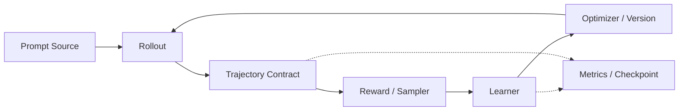

# 参考系统的演化主线

课程统一围绕一个逐步增长的 RL Training System。首先验证数据和概率语义，再引入 GPU、分布式训练与异步执行。实际测量与设计推导要分开记录。

## 阶段 1：Day 01–10，先跑通一个正确的小系统

| 课程 | 本日概念 | 主线代码与验证目标 |
|---|---|---|
| 01 | Trajectory 与 Group | 按 ID Join Reward；版本校验、Mask 校验与错配负例 |
| 02 | Transformer 计算与显存 | CPU 显存账本，区分朴素 Attention Score 与 FlashAttention |
| 03 | Autograd 与梯度累积 | 完整 Batch 和 Micro-batch 反向梯度对照 |
| 04 | Policy Gradient 与 Logprob | Token Shift、有效 Mask、Reduction 权重和梯度方向 |
| 05 | Value / GAE | 计算 TD Error 和有限长轨迹的 GAE；验证边界 |
| 06 | PPO | Ratio、Clip、KL 以及 Old/Current Policy 版本 |
| 07 | GRPO | Group Advantage、长度归一化及全组数据要求 |
| 08 | 最小 Rollout Loop | 把 Prompt、采样、Reward、Mask 和组数据连成可验证循环 |
| 09 | 最小 Learner Loop | 接入 Current Logprob、Loss、Backward、Optimizer 和 Version Check |
| 10 | 最小训练系统 | CPU Toy Policy 的 Rollout→Reward→Learner→Checkpoint，演示恢复与负例 |

### 固定实验背景

教材的数量级沙盘为 1B Dense Policy、4 GPU（2 Rollout、2 Training）、64 Groups × 4 Trajectories、Prompt 512 / Response 128 Token。**CPU 参考系统用更小的 Toy Model**，仅验证概率与数据语义，不把 Toy Bandit 吞吐当成 LLM 的性能。

### 端到端 Day 10 验收

至少验证：采样生成唯一 Trajectory ID；Reward 按 ID 对齐；Policy Version 可追踪；Mask 与 Loss 一致；梯度和 Loss 有限；Checkpoint 恢复 Policy、Optimizer 和 Step 后与不中断执行相符；至少一个错误输入被拒绝。Reward 改善不应靠单次短跑的偶然结果判断，需要多 Seed 对照。

## 阶段 2：Day 11–40，换算真实 GPU 成本

Day 20 输出带硬件、软件版本、Trace 和 Baseline 的性能报告；Day 30 把同一系统的训练侧映射到 TP/PP/FSDP/EP，区分计算量、通信量和通信拓扑；Day 40 把 Rollout 侧映射到实际推理服务，记录 TTFT、TPOT、吞吐、P50/P95、KV Cache 和权重更新成本。

## 阶段 3：Day 41–80，支持 Agentic 和异步系统

Day 50 将单轮数据契约扩展到 Tool Call/Observation/Action Mask，加入 DataSampler/TransferQueue 与 Backpressure。Day 60 对同步与异步进行公平对照，注明 Policy Version、Staleness、Accepted、Inflight 和 Drain 时刻。Day 70 验证故障恢复与幂等，Day 80 完成 Logprob Drift、混精和确定性的验证清单。

## 阶段 4：Day 81–100，作品集与面试

代码和设计都指向同一参考系统。面试陈述要能沿着“问题 → 约束 → 决策 → 验证 → 代价”回答，不得用未测量的吞吐提升冒充项目成果。个人项目叙事建议保存在本地私有笔记中，面试时以可公开的证据表述实际决策和实验结果。课程发布不依赖学习者提交这类材料。

## 自由学习与每日发布

网站中的 Day 01–100 按日期依次发布；已发布内容随时可看，作答与阶段验收是可选的自我诊断，不作为解锁条件。复习和错题库也独立于课程发布日期。

## 证据等级

- **designed**：推导或方案完成，尚未运行。
- **implemented**：代码实现完成，有对应测试，但未取得可复现性能测量。
- **measured**：记录硬件、软件、配置、原始输出和重复测量方法之后获得实测结果。

参考架构的字段契约见 [data_contract.md](../architecture/data_contract.md)，版本语义见 [versioning.md](../architecture/versioning.md)。
