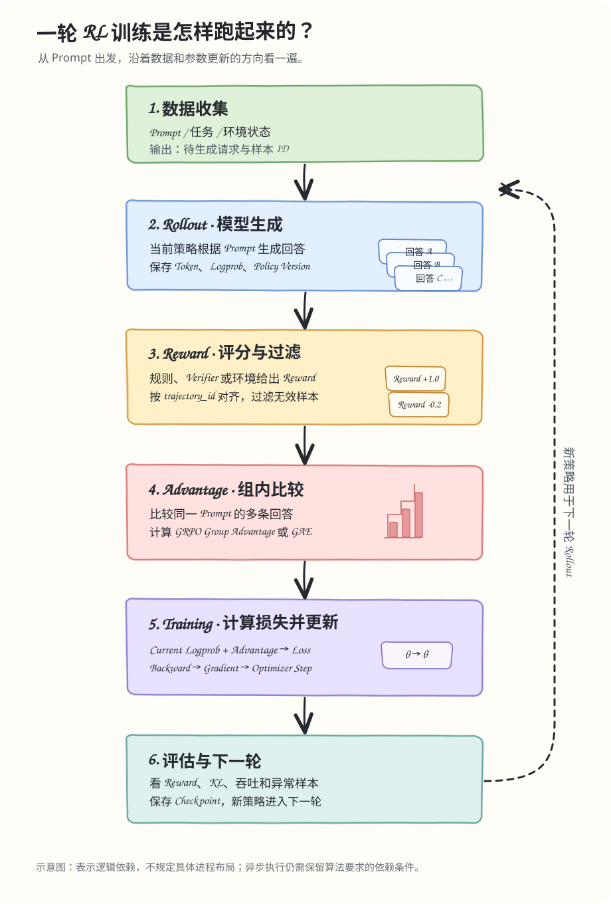

# Day 01/100 · 一条 RL 训练样本怎样变成一次参数更新

**所属模块**：RL 与训练基础  
**学习目标**：从 Prompt 讲到 Optimizer Update；理解训练数据里必须保留的身份、Mask 和策略版本信息。  
**学习产出**：画出训练数据流；能解释四个关键字段；完成一个最小数据契约检查。

## 1. 从一个例子开始

Prompt 是“计算 17 × 19，并说明过程”。Rollout Policy 生成回答，Verifier 检查结果并给 Reward。Trainer 根据 Reward、策略概率和算法目标计算 Loss，再通过反向传播更新参数。更新后的权重随后同步到 Rollout，下一轮生成使用新策略。

SFT 通常使用数据集中已有的目标答案；RL 的回答由策略生成，Reward 也必须和生成它的轨迹关联起来。这让 RL 多出一类工程问题：数据不只是要传到正确的 GPU，还要保持它原来的语义。

## 2. 一轮训练的路径

每个方框代表一个逻辑阶段，不意味着必须由不同进程执行。可以同卡运行，也可以把 Rollout 和 Training 分开；改变部署方式不能改变算法需要的数据依赖。

## 3. 固定例子

前十课使用同一组便于估算的参数：

- Policy：约 1B 参数的 Dense Transformer。
- 4 张 GPU：2 张负责 Rollout，2 张负责 Training。
- 64 个 Prompt Group，每组生成 4 条轨迹，共 256 条。
- Prompt 约 512 Token，Response 约 128 Token。
- 暂时假设每组四条轨迹均有效，且来自同一个策略版本。

这是课程用的计算沙盘，不是唯一部署方案，也不是实测配置。

## 4. Trajectory 不只是回答文本

训练数据至少需要保留这些信息：

| 字段 | 用途 | 丢失或错配的风险 |
|---|---|---|
| `trajectory_id` | 标识单条轨迹 | Reward 可能配给另一条回答 |
| `response_ids` | 实际生成的 Token | Logprob 与动作错位 |
| `response_mask` | 哪些 Token 参与 Loss | Padding 或无效 Token 进入训练 |
| `reward` | 轨迹评分 | 无法追踪优化信号 |
| `group_id` | 标识同一 Prompt 的组 | GRPO 组内统计错误 |
| `policy_version` | 记录生成策略版本 | 无法分析样本新旧与概率语义 |

字段名称可以因框架而异。这里定义的是数据契约需要表达的信息，不代表 VERL 使用完全相同的 Schema。

## 5. 三个不变量

**样本身份不变。** Trajectory、Reward、Mask 和 Logprob 必须能对应到同一条样本。Tensor Shape 一致不代表语义正确。

**概率来源明确。** Rollout Logprob 是生成时记录的概率；Old Logprob 是算法更新时固定使用的比较基准；Current Logprob 是当前参数重新计算的概率。三者可能相同，也可能不同。

**算法依赖不能被调度绕开。** 标准 GRPO 的组内 Advantage 依赖同组 Reward。四条轨迹还没收齐时，不能假设完整的四样本组统计已经可用。反过来，如果其他 Group 已经完整，也不一定必须等整个外层 Batch 返回。能否提前训练，还取决于 Trainer 的批次、梯度累积和版本策略。

## 6. 做一次数量级计算

Response Token 总数：

$$
64\ \text{groups}\times4\ \text{trajectories/group}\times128\ \text{tokens}
=32768\ \text{tokens}.
$$

如果每条轨迹总长为 512 + 128 = 640 Token，整个批次的输入 Token 位置数为：

$$
256\times640=163840.
$$

这是 Token 位置数，不是 FLOPs。实际计算量还取决于层数、Hidden Size、Attention 实现、Padding 和重计算。

## 7. 动手练习

运行 [`trajectory_contract.py`](../../examples/day_01/trajectory_contract.py)，检查每个 Group 是否恰好有 4 条轨迹、ID 是否重复、Reward 是否有限，以及 Response 与 Mask 的长度是否一致。

先运行正确样本，再分别删除一条轨迹、复制一个 ID、把 Reward 改成 NaN。记录每种输入为什么应该失败。实验只检查数据结构，不模拟完整 RL 算法。

## 8. 面试练习

**题 1（10 分）**：用两分钟解释一条 RL 样本从 Prompt 到参数更新的路径。

评分：Rollout/轨迹 2 分；Reward/Advantage 2 分；Logprob/Loss 2 分；Backward/Optimizer 2 分；版本与权重同步 2 分。

**题 2（10 分）**：GRPO 一个 Prompt 要生成 4 条轨迹。只完成 3 条时，能否计算标准的四样本 Group Advantage？

评分：指出组内统计不完整 3 分；说明提前计算会改变统计量或目标 3 分；提出等待、补投或显式改变算法契约的方案 2 分；讨论长尾和资源成本 2 分。

追问：Group A 已完成，Group B 仍在生成，是否一定要等 B？回答需要区分组内依赖和外层 Batch Barrier，并考虑 Trainer 的批次、版本与采样器契约。

## 9. 本课复盘

不看正文，画出训练数据流，并说明 `trajectory_id`、`group_id`、`response_mask` 和 `policy_version` 各自解决什么问题。说不清的概念记入学习进度，下一次针对性复习。

下一课：Transformer 前向、反向和显存。沿用同一批次，计算模型状态与 Activation 的成本。

## 10. 参考资料

- **HybridFlow: A Flexible and Efficient RLHF Framework** (2024). 用于理解 RLHF 训练中不同计算阶段如何组织和编排。https://arxiv.org/abs/2409.19256
- **VERL 官方仓库**。对照真实训练流程和数据结构时使用；阅读前先确认当前分支与配置。https://github.com/verl-project/verl
- **Proximal Policy Optimization Algorithms** (Schulman et al., 2017). 本课只建立数据流背景，PPO 的目标函数会在 Day 06 细讲。https://arxiv.org/abs/1707.06347

## 项目对照（由你填写）

回想一个采样系统：同一组结果必须收齐时，哪些等待是算法依赖，哪些只是外层 Batch Barrier？先写问题和证据，不需要公开公司名称或内部指标。

把经过脱敏、且你确认可以公开的内容记到 个人项目笔记（仅在本地记录，不提交公开仓库）。
