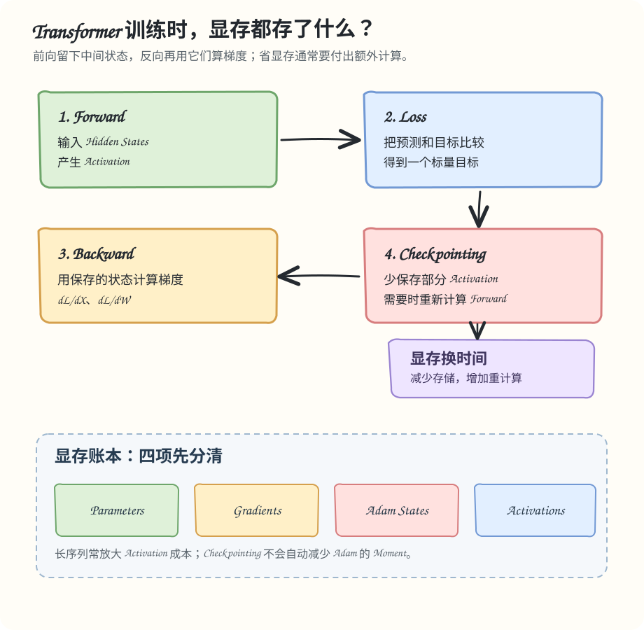

# Day 02/100 · Transformer 前向、反向与显存

**所属模块**：RL 与训练基础  
**学习目标**：区分参数、梯度、优化器状态和 Activation；解释 Attention 的序列长度成本；根据 OOM 发生阶段提出排查顺序。



## 1. 训练显存有哪几笔账？

训练显存不只是模型权重。还要考虑 Parameters、Gradients、Optimizer States、Activations 和 Temporary Buffers。具体 Dtype 与优化器实现会改变账本；以下都是明确假设下的估算。

## 2. 为什么反向传播需要前向数据？

对一个 Linear 层：

$$
Y=XW.
$$

权重梯度为：

$$
\frac{\partial\mathcal L}{\partial W}
=X^\top\frac{\partial\mathcal L}{\partial Y}.
$$

因此计算权重梯度需要前向输入 X。Autograd 会保存反向所需的部分 Tensor 或状态；具体保存哪些内容由算子实现决定，并不是所有 Forward 输出都会被保留。

Transformer Block 的候选中间值包括 Hidden States、Norm 数据、MLP 中间激活和 Attention Backward 所需状态。

## 3. Attention 为什么对长序列敏感？

标准 Attention 包含：

$$
QK^\top,\qquad
\operatorname{softmax}\left(\frac{QK^\top}{\sqrt{d_h}}\right)V.
$$

如果显式物化 Attention Score/Probability，逻辑形状为 [B, heads, L, L]，存储量随 L 的平方增长。序列长度扩大 2 倍，矩阵元素数扩大 4 倍。

例：B=2、heads=16、L=640、每元素 2 Bytes：

$$
2\times16\times640^2\times2
=26{,}214{,}400\ \text{bytes}
\approx25\ \text{MiB}.
$$

若 L=8320，同一矩阵约为 4.13 GiB。这是显式保存完整矩阵的朴素估算，不是 FlashAttention 的实际显存占用。FlashAttention 通过分块和在线 Softmax 避免长期物化完整矩阵，但不会让标准全 Attention 的算术复杂度自动变成线性。

## 4. 1B 参数的状态账本

假设 1B 参数，BF16 Parameters 和 Gradients 各按 2 Bytes/参数，Adam 的两个 Moment 各按 FP32 的 4 Bytes/参数：

| 项目 | 估算 |
|---|---:|
| Parameters | 2 GB |
| Gradients | 2 GB |
| Adam 一阶矩 | 4 GB |
| Adam 二阶矩 | 4 GB |
| 合计 | 12 GB |

还没包含 Activation、Workspace、通信 Buffer 和可能的 FP32 Master Weights。普通 DDP 每张训练 GPU 都保留完整模型状态；FSDP/ZeRO 会按配置分片相关状态。

## 5. Activation Checkpointing

Checkpointing 不保存部分中间激活，而在 Backward 需要时重新执行对应 Forward。它用额外计算换取更低的激活显存。

~~~mermaid
flowchart LR
    A["Forward"] --> B["保存边界状态"]
    B --> C["释放部分中间激活"]
    C --> D["Backward 需要中间值"]
    D --> E["重新计算 Forward"]
    E --> F["继续 Backward"]
~~~

如果 OOM 主要来自 Optimizer States，Checkpointing 不是直接解决方案。它主要影响激活的保存与重计算。

## 6. OOM 先看发生阶段

- 初始化时 OOM：核算参数、梯度、Optimizer States 和分片方式。
- Forward 时 OOM：检查 Micro-batch、序列长度、Attention Backend 和 Activation。
- Backward 时 OOM：检查激活与梯度峰值重叠、Workspace 和重计算策略。
- 运行多步后持续增长：检查 Tensor 引用、计算图保留和分配生命周期。

torch.cuda.max_memory_allocated() 统计 PyTorch 管理的 Tensor 分配峰值，不等于进程的全部 GPU 占用，也不能覆盖所有框架外分配。

## 7. 动手练习

从仓库根目录运行 [显存估算实验](../../examples/day_02/memory_budget.py)：

```bash
python examples/day_02/memory_budget.py
python -m unittest discover -s examples/day_02 -p 'test_*.py' -v
```

随后手算长度 640、1280 和 8320 对应的显式 Attention Score 张量大小。再加入一项假设：如果存在 FP32 Master Weights，1B 模型状态账本会增加多少？代码只计算朴素模型，不是 GPU Profiler 的实测值。

## 8. 面试题

**题 1（10 分）**：BF16 权重只有约 2 GB，为什么 1B 模型训练仍可能 OOM？

评分：Parameters/Gradients 2 分；Optimizer States 2 分；Activations 3 分；Workspace 与峰值生命周期 2 分；说明估算假设 1 分。

**题 2（10 分）**：长上下文从 4K 增加到 32K 后 OOM，先验证哪些优化？

评分：区分二次 Attention 与线性激活 3 分；核对实际 Attention Backend 2 分；比较 Micro-batch 和 Checkpointing 2 分；解释吞吐取舍 2 分；提出测量方法 1 分。

## 参考资料

- PyTorch Activation Checkpointing：https://docs.pytorch.org/docs/stable/checkpoint.html
- PyTorch Scaled Dot Product Attention：https://docs.pytorch.org/docs/stable/generated/torch.nn.functional.scaled_dot_product_attention.html
- Dao et al. (2022), *FlashAttention: Fast and Memory-Efficient Exact Attention with IO-Awareness*. https://arxiv.org/abs/2205.14135
- Megatron Core：https://docs.nvidia.com/megatron-core/developer-guide/latest/

下一课：Autograd、AdamW 与梯度累积。我们会把显存账本中的梯度和优化器状态，连接到真正的参数更新过程。


## 项目对照（由你填写）

选一个你见过的 OOM 或显存规划问题：它发生在初始化、Forward、Backward，还是多步运行后？当时有哪些证据能区分 Activation 与模型状态？

把可以公开的判断依据记到 [项目叙事记录](https://github.com/Kairosxy/rl-infra-100days/blob/main/portfolio/project_narrative.md)，没有测量的数据标为“尚未测量”。
