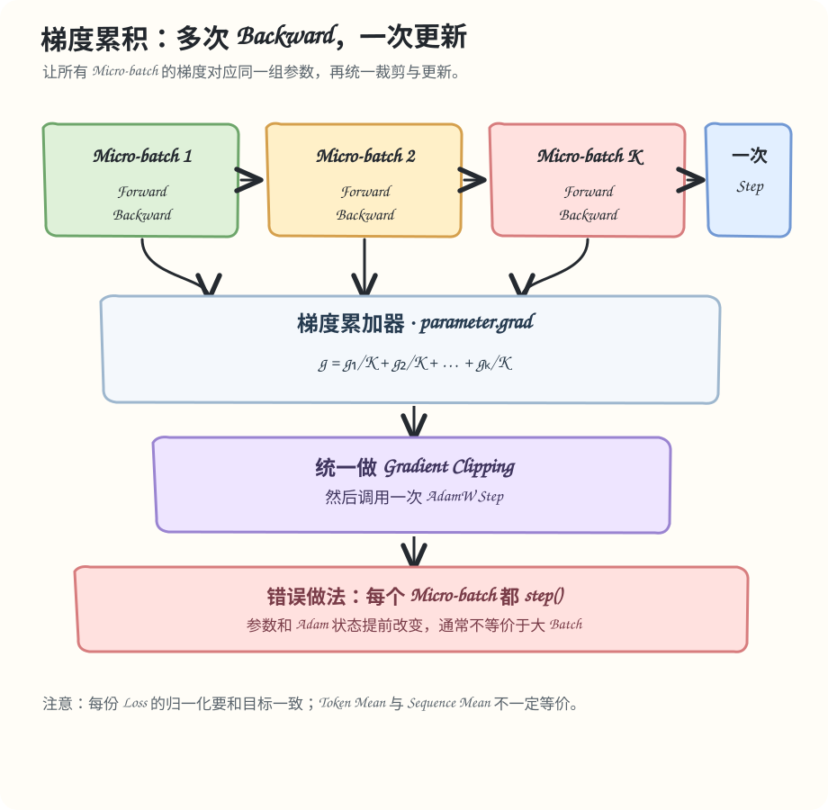

# Day 03/100 · Autograd、AdamW 与梯度累积

**所属模块**：RL 与训练基础  
**学习目标**：推导梯度累积的等价条件；解释 AdamW 状态更新；理解 DDP 梯度同步时机和 Loss Reduction 的影响。



## 1. Autograd 负责计算梯度，不负责定义目标

完整 Batch 的样本平均 Loss：

$$
\mathcal L(\theta)=\frac{1}{N}\sum_{i=1}^{N}\ell_i(\theta).
$$

把数据拆成 K 个等大小 Micro-batch，且每个 Micro-batch 的 Loss 是局部样本平均时：

$$
\nabla_\theta\mathcal L
=\frac{1}{K}\sum_{k=1}^{K}\nabla_\theta\mathcal L_k.
$$

因此，等大小 Micro-batch 的平均 Loss 通常要除以累积次数。PyTorch 会把多次 backward() 的梯度累加到 parameter.grad，但不会替你选择 Token Mean、Sequence Mean 或样本平均。

## 2. 正确的更新边界

~~~mermaid
flowchart TD
    A["zero_grad"] --> B["Micro-batch Forward"]
    B --> C["Backward：累积梯度"]
    C --> D{"还有 Micro-batch？"}
    D -- "是" --> B
    D -- "否" --> E["Gradient Clipping"]
    E --> F["AdamW Step"]
    F --> G["更新 Scheduler / global_step"]
~~~

如果每个 Micro-batch 都调用 optimizer.step()，参数和 Optimizer State 会不断变化；后续梯度就不再来自同一组参数。这与完整 Batch 的一次更新不同。

## 3. AdamW 的状态

一阶矩与二阶矩：

$$
m_t=\beta_1m_{t-1}+(1-\beta_1)g_t,
\qquad
v_t=\beta_2v_{t-1}+(1-\beta_2)g_t^2.
$$

偏差修正：

$$
\hat m_t=\frac{m_t}{1-\beta_1^t},
\qquad
\hat v_t=\frac{v_t}{1-\beta_2^t}.
$$

参数更新包含解耦 Weight Decay：

$$
\theta_t=(1-\eta_t\lambda)\theta_{t-1}
-\eta_t\frac{\hat m_t}{\sqrt{\hat v_t}+\epsilon}.
$$

每个 Optimizer Step 都会推进 Moment 和 Step Counter。把一次更新拆成多次 step() 会改变算法轨迹。

## 4. Gradient Clipping 的位置

Gradient Clipping 是非线性操作。通常先累积完整梯度，再做 Global Norm Clipping，然后执行 Optimizer Step。逐 Micro-batch 先裁剪再累积，一般不等价。

混合精度训练还要遵循 GradScaler 的 Unscale、Clip、Step 顺序；具体规则要按使用的 AMP 实现核对。

## 5. DDP 的通信成本

普通 DDP 在 Backward 期间同步梯度。梯度累积时，可通过 no_sync() 延迟非最后一个 Micro-batch 的常规梯度同步；Forward 也必须位于 no_sync() 上下文内。

Ring All-reduce 的每 Rank 发送量模型：

$$
V_{\mathrm{send}}=2\frac{P-1}{P}S.
$$

当 DP=2、梯度总量 S=2 GB 时，每 Rank 发送量约为 2 GB。若每个 Micro-batch 都同步 64 次，模型中的发送量约 128 GB；最后一次才同步约 2 GB。这个估算忽略启动、拓扑和计算重叠，不代表 Step Time 会提升 64 倍。

## 6. RL 中的 Token Reduction

若目标是全局有效 Token Mean：

$$
\mathcal L=
\frac{\sum_{i,t}m_{i,t}\ell_{i,t}}
{\sum_{i,t}m_{i,t}}.
$$

不同 Micro-batch 的有效 Token 数可能不同，直接把每个 Micro-batch 的 loss.mean() 等权平均可能改变样本权重。应按目标 Loss 的分母归一化，而不是机械地除以累积次数。

## 7. 动手练习

运行 [梯度累积实验](../../examples/day_03/gradient_accumulation_lab.py)。实验有 5 条样本，按每个 Micro-batch 2 条拆成 2、2、1，故意制造最后一个 Micro-batch 较短的情况。

```bash
python examples/day_03/gradient_accumulation_lab.py
python -m unittest discover -s examples/day_03 -p 'test_*.py' -v
```

先预测：按全局样本数归一化和把三个局部 Mean 等权平均，哪一种会匹配完整 Batch？再运行测试，并解释误差来自分母而不是浮点舍入。扩展任务：将 Optimizer Step 放进 Micro-batch 循环，检查 AdamW Step Counter 与参数差异。

## 8. 面试题

**题 1（10 分）**：梯度累积在什么条件下等价于大 Batch？

评分：梯度推导 3 分；Loss Reduction 2 分；Optimizer Step 边界 2 分；Batch-dependent 操作 1 分；浮点差异 2 分。

**题 2（10 分）**：DP=2、每 GPU Micro-batch=2、Global Batch=256 时，累积步数是多少？如何减少重复 All-reduce？

评分：算出 64 步 3 分；解释 DDP 平均语义 2 分；正确使用 no_sync() 3 分；性能权衡 2 分。

## 参考资料

- PyTorch Autograd：https://docs.pytorch.org/docs/stable/notes/autograd.html
- PyTorch AdamW：https://docs.pytorch.org/docs/stable/generated/torch.optim.AdamW.html
- PyTorch DDP：https://docs.pytorch.org/docs/stable/generated/torch.nn.parallel.DistributedDataParallel.html
- PyTorch AMP：https://docs.pytorch.org/docs/stable/amp.html

下一课：Policy Gradient 与 Logprob。我们会把可微梯度路径连接到离散 Token 和不可微 Reward。


## 项目对照（由你填写）

回想一次梯度累积、Loss Reduction 或 DDP 通信问题。记录当时的目标分母、更新边界和验证方法；如果没有可复用的真实案例，就用本课实验结果，不要把假设写成项目事实。

将脱敏后的决策记到 个人项目笔记（仅在本地记录，不提交公开仓库）。
