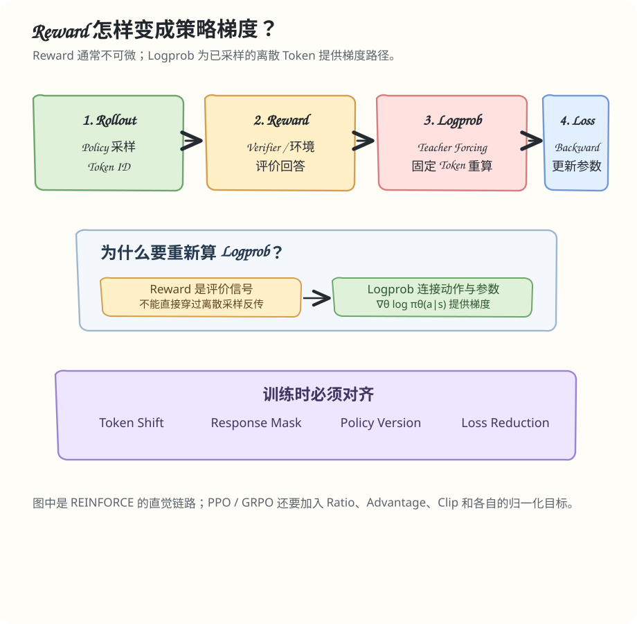

# Day 04 图解 · Reward、Logprob 与梯度

## 读图

1. Rollout 负责生成离散 Token；采样本身不是普通的可微操作。
2. Reward 评价回答或环境结果，通常不通过模型计算图反向传播。
3. Trainer 固定已生成 Token，使用 Teacher Forcing 重新计算当前策略的 Logprob。
4. Policy Gradient 把 Reward / Advantage 作为权重，利用 Logprob 的梯度更新策略。

图中的 L = -R log πθ 是简化示意。完整序列需要对 Token Logprob 求和或按所选目标归一化。PPO / GRPO 还包含各自的 Ratio、Advantage、Mask 和正则项，不能把图中的简式当作完整 PPO Loss。
