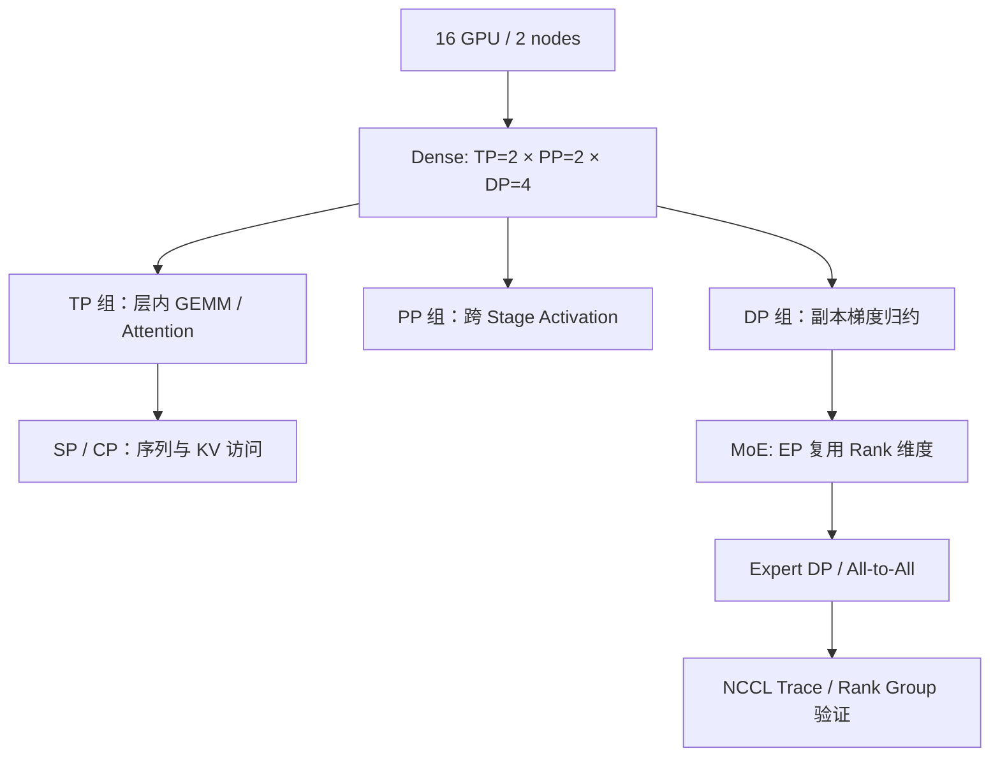

# Megatron Core：16 张 GPU 怎样组成 TP、PP、DP、EP、CP？

## 先看拓扑，而不是先填配置



**问题**：16 张 GPU，Dense TP=2、PP=2、DP=4；为什么只改 Rank Order，跨节点通信就可能换一条链路？

**源码已核实**：NVIDIA/Megatron-LM 固定提交 [`f677840c` 的 `parallel_state.py`](https://github.com/NVIDIA/Megatron-LM/blob/f677840c61068c33409a5da1756a5ae3c9cd4791/megatron/core/parallel_state.py) 中，`initialize_model_parallel` 默认 `order="tp-cp-ep-dp-pp"`；`RankGenerator` 与 `generate_masked_orthogonal_rank_groups` 按各维 stride 生成正交 Rank Group。这里取 CP=1、Dense EP=1、GTP=1，其余参数为默认。以下是对该算法的**纸面推导**，不是已运行的 NCCL 测试。

`tp-cp-ep-dp-pp` 从左到右 stride 递增，故 `global_rank = tp_rank + 2 × dp_rank + 8 × pp_rank`。对 Rank 0：

| 配置 | TP 组 | DP 组 | PP 组 |
|---|---|---|---|
| `tp-cp-ep-dp-pp` | [0,1] | [0,2,4,6] | [0,8] |
| `tp-cp-ep-pp-dp` | [0,1] | [0,4,8,12] | [0,2] |

第二行把 PP 放在 DP 内侧，因此 `global_rank = tp_rank + 2 × pp_rank + 4 × dp_rank`。若 Rank 0–7 恰好在节点 A、8–15 在节点 B，第一行的 Rank 0 PP 组跨节点而 DP 组不跨；第二行恰好相反。**这是指定物理 Rank 排列后的条件结论**，不是 Megatron 自动保证的 GPU Placement。

```python
# 需要安装与上述固定提交一致的 Megatron Core；只计算 Rank 列表，不启动 NCCL。
from megatron.core.parallel_state import RankGenerator

for order, expected_dp, expected_pp in [
    ("tp-cp-ep-dp-pp", [0, 2, 4, 6], [0, 8]),
    ("tp-cp-ep-pp-dp", [0, 4, 8, 12], [0, 2]),
]:
    groups = RankGenerator(tp=2, ep=1, dp=4, pp=2, cp=1, order=order)
    assert [0, 1] in groups.get_ranks("tp")
    assert expected_dp in groups.get_ranks("dp")
    assert expected_pp in groups.get_ranks("pp")
```

**不能把 EP 再乘到 Dense GPU 总数上。** 同一源码为 Dense 与 Expert 构造不同 RankGenerator：Expert 的 DP 由 `world_size / (expert_tp × expert_ep × pp × expert_gtp)` 计算，并校验 Dense/Expert 的 PP 组一致性。以 16 GPU、Expert TP=2、EP=4、PP=2、Expert GTP=1 为例，Expert DP=1；这仅证明维度整除，不代表所有 Rank Order、Dispatcher 或通信 Backend 组合都能运行。

**验证顺序**：先运行纯 Rank Group 断言，再在每个进程记录 `rank → hostname/device → TP/DP/PP/EP group`；最后用 NCCL/Nsight 对比 PP P2P 与 DP Gradient Reduce 的跨节点次数、字节、等待和关键路径。改变 Rank Order 可能使 PP 更快而 DP 更慢，不能只凭组大小或带宽理论下界判断总 Step 加速。
## 从计算语义到实现

**TP** 将线性层拆成 Column/Row GEMM，前向与反向的 Reduce/Scatter/All-Gather 路径取决于 Sequence Parallel 布局；检查 `ColumnParallelLinear`、`RowParallelLinear`。**PP** 在层边界传输 Activation 与梯度，调度通常包括 Forward/Backward 的不同阶段；检查 `pipeline_model_parallel_size`、Micro-batch、Virtual Pipeline。**DP** 在对应副本上归约梯度，可能通过 Distributed Optimizer 或 FSDP 式状态分片改变实际通信。**EP** 在 Router 后进行 Token Dispatch/Combine；检查 Expert Parallel Group 与 All-to-All。**CP** 负责长序列上下文分片及 Attention 的 KV 交换，不能与 SP 直接等同。

前面的 `RankGenerator` 是本节的可执行源码定位实验；实际训练还必须核对进程组初始化与 GPU 物理拓扑。
## 成本与边界

在一个 BF16 线性层 `X[4,4096] @ W[4096,8192]` 中，W 占 64 MiB；TP2 后每卡该层权重 32 MiB，局部 GEMM 约占原算子一半 FLOPs。DP4 不再减少该层每卡权重；PP2 通过分层降低每卡常驻层数，但带来 Activation P2P 和 Bubble。若跨 PP Stage 发送 `[1,2048,4096]` BF16 Activation，载荷 16 MiB；有效 100 GB/s 的理想纯带宽下界约 0.168 ms，实际有启动/等待。

| 对象 | 形状/单位 | 所在模块 | 记录什么 |
|---|---|---|---|
| TP group | 2 ranks | Model Parallel Init | 全部成员及节点 |
| DP group | 4 ranks | Gradient/Optimizer | 归约耗时与 Byte |
| PP activation | [1,2048,4096] | P2P Send/Recv | Stage 时间与 Bubble |
| EP routing | Token→Expert | MoE Dispatcher | 每 Expert Token 数 |
| CP KV | [B,T,kv_heads,dim] | Attention | KV 交换、Position |

## Debugging

GPU OOM → 区分参数/优化器、Activation、KV 和 Collective Buffer；TP 增大后变慢 → 看组是否跨节点及 NCCL；MoE Rank 长尾 → 看 Expert Token 分布；训练 Hang → 对照所有 Rank 的最后一次 Collective 和 PP Send/Recv 顺序；数值偏差 → 固定输入与参数，分别关闭 CP/EP/TP 缩小范围。

**验证实验**：① TP1/2/4 比较 GEMM 与 NCCL；② PP1/2/4 改 Micro-batch 绘制时间线；③ 固定 Expert Routing，EP1/2/4 比较 Token 分布和 All-to-All。所有性能数值需实测，不以理论下界冒充收益。

**其他路径的源码入口（仍需按实际使用的 Commit 核验）**：[Megatron Core](https://github.com/NVIDIA/Megatron-LM/tree/main/megatron/core) 中 parallel_state、tensor_parallel、pipeline_parallel、transformer/moe；[官方开发文档](https://docs.nvidia.com/megatron-core/developer-guide/latest/index.html)。
