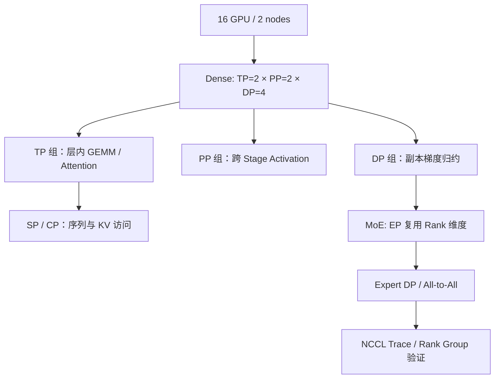

# Megatron Core：16 张 GPU 怎样组成 TP、PP、DP、EP、CP？

## 先看拓扑，而不是先填配置



**锚点**：两节点各 8 GPU，Dense 层配置 TP=2、PP=2、DP=4，乘积为 16。为说明 Group，假设 Rank 顺序按 PP 最外层、DP 次之、TP 最内层排列：`rank = ((pp_rank × 4 + dp_rank) × 2 + tp_rank)`。这是**教学自定义映射**，不保证等于某版本 Megatron 的实际 Rank Order；真实 Group 必须打印运行时成员核对。

固定 PP=0、DP=0，TP 组为 [0,1]；固定 PP=0、TP=0，DP 组为 [0,2,4,6]；固定 DP=0、TP=0，PP 组为 [0,8]。TP 组应优先位于高带宽互联内，PP 的跨 Stage 通信和 DP 梯度归约另行衡量。把 EP=4 写入配置**不意味着再需要 4 倍 GPU**：Expert Parallel 组与 Expert Data Parallel 组需要从现有 Rank 拆分或重组，且 Dense/MoE 层通信域可能不同。

## 从计算语义到实现

**TP** 将线性层拆成 Column/Row GEMM，前向与反向的 Reduce/Scatter/All-Gather 路径取决于 Sequence Parallel 布局；检查 `ColumnParallelLinear`、`RowParallelLinear`。**PP** 在层边界传输 Activation 与梯度，调度通常包括 Forward/Backward 的不同阶段；检查 `pipeline_model_parallel_size`、Micro-batch、Virtual Pipeline。**DP** 在对应副本上归约梯度，可能通过 Distributed Optimizer 或 FSDP 式状态分片改变实际通信。**EP** 在 Router 后进行 Token Dispatch/Combine；检查 Expert Parallel Group 与 All-to-All。**CP** 负责长序列上下文分片及 Attention 的 KV 交换，不能与 SP 直接等同。

```text
rank_layout = initialize_parallel_groups(tp=2, pp=2, dp=4)
for group in all_groups:
    log(group.kind, group.ranks, group.backend)
assert all_ranks_accounted_for()
trace_forward_backward_and_collectives()
```

以上为验证逻辑伪代码，不是 Megatron API。

## 成本与边界

在一个 BF16 线性层 `X[4,4096] @ W[4096,8192]` 中，W 占 64 MiB；TP2 后每卡该层权重 32 MiB，局部 GEMM 约占原算子一半 FLOPs。DP4 不再减少该层每卡权重；PP2 通过分层降低每卡常驻层数，但带来 Activation P2P 和 Bubble。若跨 PP Stage 发送 `[1,2048,4096]` BF16 Activation，载荷 16 MiB；有效 100 GB/s 的理想纯带宽下界约 0.168 ms，实际有启动/等待。

| 对象 | 形状/单位 | 所在模块 | 记录什么 |
|---|---|---|---|
| TP group | 2 ranks | Model Parallel Init | 全部成员及节点 |
| DP group | 4 ranks | Gradient/Optimizer | 归约耗时与 Byte |
| PP activation | [1,2048,4096] | P2P Send/Recv | Stage 时间与 Bubble |
| EP routing | Token→Expert | MoE Dispatcher | 每 Expert Token 数 |
| CP KV | [B,T,kv_heads,dim] | Attention | KV 交换、Position |

## Debugging

GPU OOM → 区分参数/优化器、Activation、KV 和 Collective Buffer；TP 增大后变慢 → 看组是否跨节点及 NCCL；MoE Rank 长尾 → 看 Expert Token 分布；训练 Hang → 对照所有 Rank 的最后一次 Collective 和 PP Send/Recv 顺序；数值偏差 → 固定输入与参数，分别关闭 CP/EP/TP 缩小范围。

**验证实验**：① TP1/2/4 比较 GEMM 与 NCCL；② PP1/2/4 改 Micro-batch 绘制时间线；③ 固定 Expert Routing，EP1/2/4 比较 Token 分布和 All-to-All。所有性能数值需实测，不以理论下界冒充收益。

**源码入口（需按项目使用的 Commit 核验）**：[Megatron Core](https://github.com/NVIDIA/Megatron-LM/tree/main/megatron/core) 中 parallel_state、tensor_parallel、pipeline_parallel、transformer/moe；[官方开发文档](https://docs.nvidia.com/megatron-core/developer-guide/latest/index.html)。
