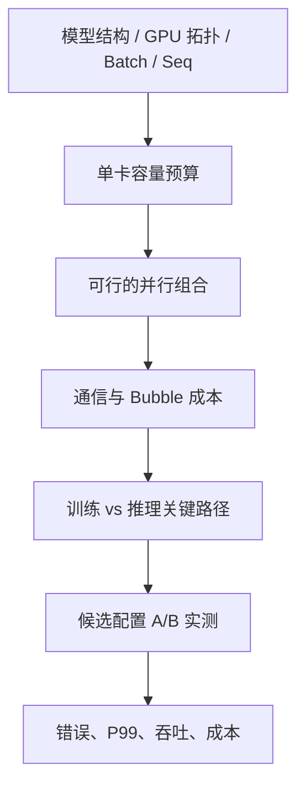

# 并行配置工作簿：给定 GPU、模型和负载，如何选 TP/PP/EP/CP/DP？

[打开 TP 性能推演实验](../../labs/parallel-performance.html)：调整 Token Batch、TP×DP、算子效率和 NCCL 假设，比较单批延迟与固定 GPU 的理想处理能力。该实验是教学成本模型，不是硬件 Benchmark。\n\n## 不从“经验推荐 TP=8”开始

**锚点**：2 节点 × 8 GPU，Dense 模型 7B 参数、BF16，训练使用 Adam，推理请求最长 65536 Token。以下是筛选逻辑，不是已验证的推荐配置。

## 性能比较必须先固定基线

并行度增大通常**降低每 GPU 的计算工作量**，但不保证降低端到端时间；新增 Collective、Pipeline Bubble、Token Routing、KV 交换可能使总耗时上升。固定总 GPU 和负载时，优先比较 `TP1×DP8` 与 `TP2×DP4` 等组合的整集群吞吐；固定单请求时才比较 TP Degree 对延迟的影响。模型无法单卡容纳时，TP1 不是有效候选。记录每 GPU 有效 Token/s、整集群 Token/s、TTFT/TPOT P99、GPU-hours/有效训练 Token，不把“理论计算 FLOPs 除以 TP”写成“理论加速比”。

**最小成本模型**：`T ≈ T_compute/p_eff + T_collective + T_bubble + T_routing + T_sync`；其中 `p_eff` 反映并行后的 Kernel 效率，部分开销可重叠，实际要用 Critical Path Trace 代替简单求和。举例单卡 20 ms 的大 GEMM，TP4 计算 5 ms + 通信 3 ms 可以变成 8 ms；小 Decode 单卡 2 ms，TP4 计算 0.5 ms + 通信 2.5 ms 则变成 3 ms。这些是教学假设，非测量结果。

## 先算容量

训练 BF16 参数约 14 GB（十进制）；BF16 梯度约 14 GB；FP32 Adam 两个 Moment 约 56 GB；若还保留 FP32 Master Weight，另约 28 GB。合计分别约 84 GB 或 112 GB 的全模型状态（不含 Activation、通信与缓存）。若用 8 Rank 均匀切分全部状态，理论常驻状态约 10.5 GB 或 14 GB/卡；**FSDP 的 All-Gather 峰值仍需要另外估算**。

推理 KV 以实际层数、KV Head、Head Dim、dtype、Sequence、并发为准。示例取 32 层、8 KV Head、128 Dim、BF16、T=65536，则单请求完整 KV=8 GiB。注意这组 KV 架构参数只是示例，不代表所有 7B 模型。

## 再判断并行维度

| 问题 | 首选检查 | 典型代价 |
|---|---|---|
| 参数与优化器状态放不下 | FSDP2/ZeRO、TP、PP | All-Gather、梯度/状态通信 |
| 单层 GEMM 太大 | TP | 层内 Collective |
| 深层模型放不下 | PP | Stage Bubble、P2P |
| MoE Expert 放不下 | EP | All-to-All、热点 |
| 长上下文训练 OOM | CP、SP、重计算 | KV 交换、重计算 |
| 推理 KV/并发受限 | TP、DP、KV Cache/PD | Decode 同步、复制权重 |
| 跨节点链路有限 | Group Rank Placement | 带宽/延迟/拥塞 |

## 一个错误示例

`TP=4, PP=2, DP=2` 满足 16 GPU；如果将 TP4 的四个 Rank 随机跨两个节点，原本可以留在节点内的层内 Collective 可能穿越慢链路。**并行度合法，不代表物理映射合理**。另外 EP/CP 的维度复用、整除关系和框架限制必须由真实初始化代码验证，不能盲目把所有 Degree 相乘。

## Math → Code

| 符号 | 含义 | 代码/配置入口 | 必须记录 |
|---|---|---|---|
| P | 参数个数 | Model Config | param count、dtype |
| TP | 张量切分数 | Megatron / Serving Config | TP group、NCCL |
| PP | Pipeline Stage 数 | Pipeline Scheduler | Bubble、Stage P95 |
| EP | Expert Group 大小 | MoE Dispatcher | Tokens/expert、A2A |
| CP | Context 切分数 | Attention | KV exchange、Mask |
| DP | 数据副本数 | Process Group | Gradient sync |
| T | 序列长度 | Sampler / Scheduler | 输入/输出分布 |
| B_eff | 有效通信带宽 | NCCL Trace | bytes / time |

## 验证与停止条件

候选配置必须同时满足：能初始化 Group、数值等价、峰值 HBM 有安全余量、无持续 Hang、达到吞吐/延迟目标。不要在没有实测时输出“加速 1.5×”。

故障树：初始化失败 → 维度整除/Group 重叠/版本支持；OOM → 训练状态 vs Activation 或推理 KV；慢 → GEMM/NCCL/Bubble/Router；漂移 → Precision/Mask/Version/Router。三组实验：① 固定 16 GPU 比较 TP2×DP8 与 TP4×DP4 的推理；② 固定 Global Batch 对照 FSDP/TP 的训练峰值；③ 固定 Expert Routing 对照 EP 的 A2A 长尾。

**建议的可视化组件**：16 GPU 拓扑网格（按节点分组），输入 TP/PP/DP，自动显示 Group 颜色与跨节点通信；EP/CP 采用单独的组定义校验而非简单相乘。显示容量估算和“需要实测”字段，不伪造吞吐。

参考：[Megatron Core](https://docs.nvidia.com/megatron-core/developer-guide/latest/index.html)、[SGLang](https://docs.sglang.ai/)、[vLLM](https://docs.vllm.ai/)。
