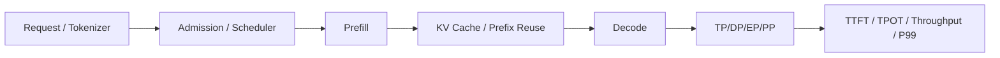

# SGLang 与 vLLM：同样 TP=4，为什么表现可能不同？

训练通常要同时考虑参数、梯度、优化器和反向通信；推理则主要面对权重、KV、请求调度和每 Token 延迟。SGLang 与 vLLM 都提供模型并行与 KV 管理，但具体 Scheduler、Cache、MoE Dispatch 和版本支持并非相同实现。

## 一个贯穿的 KV 例子

32 层、KV Head=8、Head Dim=128、BF16、T=65536。单请求完整 KV（未压缩、未分片、无滑窗）为 `2 × 32 × 8 × 128 × 65536 × 2 = 8 GiB`。4 个互不共享前缀的满长请求合计 32 GiB 逻辑 KV。若 KV Head 在 TP4 上均匀分片，理想每卡约 2 GiB/请求；实际还受不同 Layer、Block 分配、Prefix Sharing、Speculative Decoding、Graph Workspace 影响。

## 为什么要分开看四类策略

**TP**：按 Attention/MLP 算子切权重与计算，层内 Collective 增加 Decode 同步；TP4 不等于请求吞吐必然 4 倍。**DP**：复制服务实例以承载独立请求，单副本要能放下权重/KV。**EP**：MoE Expert 分配给 Rank，Token Router 与 All-to-All 可能成为关键路径；部分实现还支持 DP Attention 与 EP 的混合布局。**PP**：分层并行并依赖 Stage 调度，适合某些模型容量与拓扑约束；与 Prefill/Decode Disaggregation（PD 分离）不是一回事。

## SGLang 需要读什么

从请求入口到 Scheduler 的 Prefill/Decode Batch 构建、KV 管理、TP Worker、MoE EP 路径，核对真实版本的启动参数和通信组。重点观察 Prefix Cache Hit、Waiting/Running Queue、Prefill Batch、Decode Batch、KV 使用率、CUDA Graph、Token Latency。SGLang 的 RadixAttention 属于前缀复用机制，不能把它等同于 PagedAttention 的全部内存管理语义。

## vLLM 需要读什么

从 Engine/Scheduler 到 KV Block 管理、Model Runner、TP/PP/DP 配置及 MoE 执行路径，核对目标版本是否支持特定组合。PagedAttention 强调块式 KV 管理；Prefix Caching、Continuous Batching 和调度实现需要单独分析，不可仅由“PagedAttention”推断性能。

| 指标 | 输入与单位 | 如何解释 | 常见误判 |
|---|---|---|---|
| TTFT | ms/request | Queue+Prefill+首 Token | 把排队当作算子慢 |
| TPOT | ms/output token | Decode 的平均节奏 | 只看平均，忽略 P99 |
| Throughput | input/output tokens/s | 并发与 Batch 的结果 | 不注明长度分布 |
| KV usage | GiB、block | 实际容量与碎片 | 只算权重 |
| NCCL | ms/collective | TP/EP 关键路径 | 把累计时间当墙钟时间 |

## 一次公平对比

固定模型 Commit、权重、精度、GPU 拓扑、输入/输出长度分布和并发目标；分别在 TP2/4/8 下测 TTFT、TPOT P50/P99、吞吐、HBM、NCCL。再固定总 GPU，对比 TP4×DP2 与 TP2×DP4，判断增加副本还是加大单实例并行更有利。对于 MoE，额外记录 Expert Token 分布与 EP Group。

排障：TTFT 高 → Queue/Prefill/Cache；TPOT 高 → Decode Batch/GEMM/NCCL/KV；OOM → 权重/KV/Graph Workspace；MoE 长尾 → Router/All-to-All；数值漂移 → Sampling、Mask、Router、Quantization、权重版本逐项排除。

**版本说明**：本文是架构阅读与实验路线，未对特定 SGLang/vLLM Commit 做源码逐行核验，具体 Flag 与支持矩阵需实测。

参考：[SGLang Docs](https://docs.sglang.ai/)、[vLLM Docs](https://docs.vllm.ai/)。
