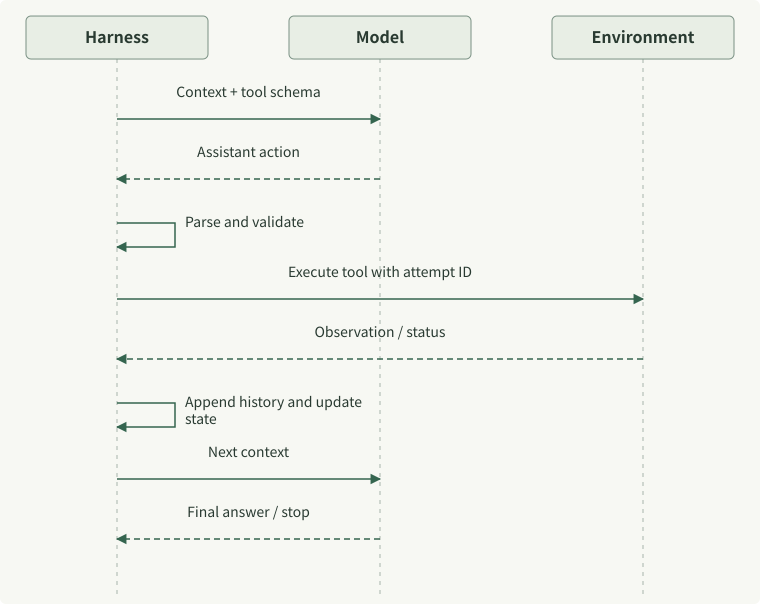

# Agent Harness、环境状态与工具执行

Agent Harness 管理模型之外的执行：组织上下文、调用模型、解析 Action、访问工具、维护环境状态并决定何时继续或结束。模型输出一段 Tool Call 并不等于工具已经执行成功。

## 一次多轮交互

例如模型先生成 8 个 Action Token，工具返回 20 个 Observation Token，模型再生成 5 个 Token，则完整交互增加 33 个 Token，而模型实际采样的位置只有 13 个。只要这些 Observation 会成为后续条件上下文，训练前向就需要包含它们或等价表示；Actor loss 则只覆盖定义中的模型 Action。详细 mask 对齐见 [Agent 的 Action](agent-action.md)。

## 环境与会话状态

假设工具操作改变某个文件，从状态 A 写成 B。模型第一次调用后收到超时，Harness 无法据此判断文件是否仍在 A。再次执行可能产生二次副作用。对只读查询可按约定重试；对有副作用的操作需 request/attempt ID、幂等能力或状态查询。记录 timeout、sandbox failure、malformed tool call、任务失败应分开，不能不加区分地作为同一种 Reward。

环境完整状态可能包含文件系统、浏览器会话、远端任务、时钟与随机源；模型能看到的只是 Observation。即使复制相同 Token，外部世界状态仍可能不同。树形 Rollout 若从共同前缀分叉，除了 KV/Token 共享，还要保证环境可独立 fork、恢复 snapshot 或按明确契约重放。

## 长上下文与信用分配

Harness 保存的完整 Transcript 与每次模型实际看到的 Context 可以不同。摘要、删除过期工具结果或截断时必须记录有效上下文及原轨迹映射；不能把未出现在实际状态中的文本当作模型采样条件。Outcome Reward 通过定义的 Return/Advantage 传播到行动，而不是为工具输出 Token 计算 Policy Gradient。Turn/Step 级信用分配需要定义动作单位与时间尺度。

先在一个确定性的假环境上复现：执行同一个 Action 两次，检查状态变化、重复调用标识、生成 mask 与终止原因；再人为注入超时和失败，确认没有重复执行有副作用的操作。该验证不依赖真实业务环境。

参考：[ReAct (2022)](https://arxiv.org/abs/2210.03629)、[Gymnasium Env API](https://gymnasium.farama.org/api/env/)、[MDP 与 Value](../rl/mdp-value-return.md)。
