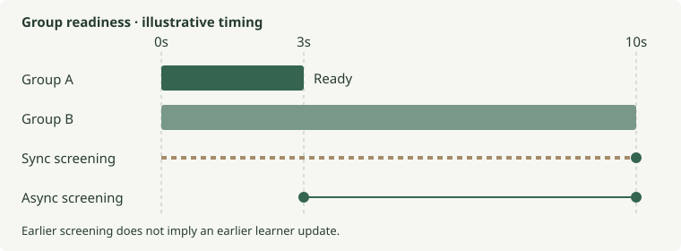

# 异步 Rollout：减少什么等待，又增加哪些错误机会？

同步训练里存在不可省略的依赖：同一 Prompt 的 Group Advantage 需要有效组完整、Learner 需要当前更新定义下的 Batch、同一 GPU 不能无限同时承担互斥工作。但等外层整个 Batch 的所有请求都完成后才开始筛选，有时只是实现造成的额外屏障。

异步供给允许 Group 或请求完成后立即进入筛选池，并根据已接受样本、Inflight 数量和历史接受率决定补投。这里**停止投新请求、达到目标有效样本数、所有在途请求排空**，是三个不同时间点。没有 Abort 时，达到目标不等于 GPU 已空闲。

## 多出来的算法问题

Rollout 开始时使用 v10 权重，Trainer 可能已更新到 v11。记录在轨迹上的 Behavior Version 不能在消费时覆盖成 v11，否则 Ratio、Staleness 和恢复逻辑都失去事实依据。Partial Rollout 如果跨 Weight Update，更需要定义每个 Token 的生成版本与恢复状态。

同样重要的是 DataSampler 的选择偏差：如果慢请求更容易被丢弃、或者全同 Reward Group 更容易被过滤，最终训练样本的分布可能改变。增加吞吐还不够，需要在相近模型质量和相同负载下比较成本。

## 框架怎么取舍

[verl HybridFlow](https://verl.readthedocs.io/en/latest/hybrid_flow.html) 把 RL 数据流与不同执行 Engine 组合；[slime](https://github.com/THUDM/slime) 强调 Megatron/SGLang 与 Data Buffer 的集成；[AReaL Async RL](https://areal-ai.io/AReaL/en/algorithms/async.html) 明确用生成/训练重叠和 Off-policyness Budget 控制异步。不能据此声称谁在所有工作负载下更快。

## 可验证的调度实验

构造两个 Group 的完成时间：A 在 3s 完整，B 在 10s 完整。同步外层筛选必须等到 10s；异步供给可以在 3s 对 A 做组内统计，但**能否立刻执行训练更新**还取决于 Mini-batch、版本和资源。统计“可更早处理”不等于测得“端到端必定加速”。

建议至少记录 Accepted Groups、Inflight、Rejected、Policy Version Gap、Drain Time 和 GPU Busy Time。没有这几项，只有 Step Time 的对照很难解释结果。

## Partial Rollout：版本年龄与概率偏移

假设一条回答的前两个 action 在 v10 生成，后两个在 v12 续写，消费时 learner 为 v13。版本年龄分别为 [3,3,1,1]；只记录最后版本会丢掉前两个 action 的来源。若四个 action 的 behavior 概率均为 0.5，current 概率分别为 [0.6,0.4,0.55,0.45]，逐 token ratio 为 [1.2,0.8,1.1,0.9]，整条轨迹的概率比为 0.9504（固定状态、相同动作空间及采样语义的教学例子）。轨迹比不等于逐 token ratio 的均值，也不意味着任意 PPO 实现应直接使用轨迹比。

版本差只能作为调度代理：同样跨三次更新，参数变化可能很小也可能很大。实际偏移需在相同 prefix、token、mask 与采样语义下比较 logprob，并记录版本跨度、ratio 分位数、clip fraction 和有效样本数。对于跨版本 KV 恢复，还需验证缓存是否由正确权重重算或失效；不能从版本字段推断缓存一定正确。

## 供给资格与完整结果的生命周期

考虑 8 个生成资格，单条请求生成耗时 2s、外部 reward 等待 8s。若资格一直占到 reward 完成，理想稳态上界为 8/10=0.8 条/s；若生成结束立即释放资格，生成侧上界为 8/2=4 条/s。后者要求 reward 侧能承接 4 条/s，按 Little 定律平均约 32 条处于 reward 等待。数字是忽略调度开销的容量模型，不是吞吐实测。

释放生成资格不等于样本已可训练。可分别维护生成中、等待 reward、完整就绪三个状态，并对等待队列设上限；组内优势仍需满足完整组条件。验证时固定请求与 reward 延迟，比较生成资格占用、reward backlog、有效组吞吐和 drain time；如果 reward 服务只能处理 1 条/s，继续补投只会增加积压。
