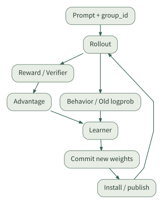

# 一次 RL 更新：模型角色与数据生命周期

RL 训练不断用策略生成数据、获得反馈、计算训练目标、更新参数，再让生成端看到新策略。先明确这条同步基线中的必要依赖，才有办法判断异步、流水或 partial rollout 减少了什么等待。

## 模型角色不是 GPU 部署图

| 角色 | 输入与产物 |
|---|---|
| Rollout / Actor inference | Prompt、当前发布权重、采样配置 → Action/Trajectory 与 Behavior 信息 |
| Reward / Verifier | 任务、轨迹、环境结果 → Reward 或其他反馈 |
| Critic（需要时） | 状态 → Value 估计，用于 Advantage/Return |
| Reference（需要时） | 固定或指定参照策略 → 约束所需 Logprob |
| Teacher（需要时） | Student 的实际上下文 → 蒸馏分布或其他监督 |
| Learner / Actor training | 已满足目标所需数据 → Gradient、Optimizer 更新、新权重 |

这些是逻辑职责，同一模型可以承担多个角色，也可由独立引擎提供服务。GRPO 不必维护独立 Critic；Reference、Teacher 或 RM 是否存在取决于目标。Learner 与 Rollout 可能共享 GPU，也可能分离部署，见 [资源规划](rl-parallel-planning.md)。

## 一组数据何时可用

假设 2 个 Prompt，每个采 4 个回答，得到 8 个 Response。GRPO 若规定每组四个有效回答，Prompt A 四条结束、B 三条结束时，可以先完成 A 的组内统计；不能用 B 的三条假装是完整四条。实际过滤、替换、动态采样规则应在算法契约中定义。

图中各字段可并行准备。Learner 消费前必须满足该目标的所有数据依赖，无关的远程调用可以继续执行。Weight Install 完成与 Optimizer Step 成功是两个事件，异步系统不能只记录一个 global step 代替所有版本。

## 轨迹数据契约

下面列出一组与具体框架无关的轨迹字段。

~~~text
sample_id, group_id, attempt_id
input_ids, action_mask, attention_mask
behavior_log_probs, policy_version, sampling_config
reward, reward_version, terminated, truncated
old_log_probs, ref_log_probs, values, advantages  # 按目标所需
field_ready, lifecycle_state
~~~

在 B=8、L=4096 的 padded batch 上，仅 int64 input IDs 约 256 KiB；FP32 行为 logprob 若为每个位置存一项则约 128 KiB。若错误地保存整个 [8,4096,128000] BF16 logits，则约 7.81 GiB。需要明确是否保留采样 Token、top-k 或完整词表，不因统一 schema 就无差别搬运所有数据。

在模型权重切换、重试和组过滤时保留身份及版本；生成完毕可以释放生成资源，但结果是否可消费要由目标字段与组状态决定。继续阅读 [异步 Rollout](async-rollout.md)、[分布式轨迹数据面](ray-data-runtime.md)、[HybridFlow 实现](../../implementations/verl/verl-hybridflow.md)。

参考：[HybridFlow: A Flexible and Efficient RLHF Framework](https://arxiv.org/abs/2409.19256)、[PPO](https://arxiv.org/abs/1707.06347)。
