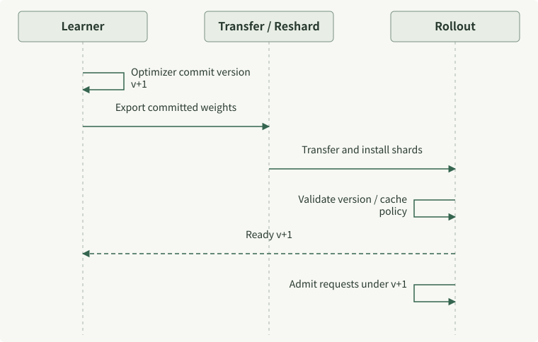

# Weight Sync、Reshard 与策略版本

训练引擎和推理引擎的并行布局通常不同。权重同步不仅是复制一份 Tensor，还需要将相同逻辑参数转换到目标 Rank、dtype、存储布局和量化表示。同步完成后，生成端才具备新策略的执行条件。

## 参数布局与传输

假设一个 Linear 权重逻辑 Shape 为 [8,8]，训练端 TP=2 按输出维切成两个 [4,8]，推理端 TP=4 需要四个 [2,8]。在切分轴一致时可以进一步分发子块；如果两侧切分轴、PP/EP 所有权或量化表示不同，就需要重新组织数据。逻辑参数名、Shape 和版本是映射依据，不能只按 Rank 编号复制。

对于一个 10B 参数的 BF16 模型，未压缩逻辑权重为 20 GB。在单条假设有效 100 GB/s 的链路完整传一次时，纯字节下界约 0.2s；真实网络可能涉及多 Rank、多副本、并行传输、额外缓冲和重排，不能将该下界当成全局同步耗时。

## 从更新到发布

图中描述一种满足完整版本发布条件的时序；框架可采用其他实现。如果部分 Rank 安装成功、另一些失败，不能把混合状态当作全局已发布版本。异步允许继续使用完整旧版本或暂停准入，具体取决于资源和策略滞后约束。Optimizer Step 因非有限梯度被 Skip 时，也要区分尝试计数与有效更新版本。

## KV 与在途轨迹

KV 是特定模型权重、输入和执行语义下生成的内部状态。改变权重通常使旧 KV 不再是新模型对同前缀的正确计算结果；除非有经证明的兼容或专门近似策略，不能原样当作新版本 Cache。Partial Rollout 可能保存已生成 Token，在新版本下重新 Prefill，再继续采样；已生成动作的 Behavior Version 仍应保留。

验证同步时固定同一组输入，在目标引擎安装前后记录参数身份、摘要或抽样一致性，核对所有 Rank 的安装版本，再对照相同 Token 的概率；同时观察在途请求、Cache 失效与版本发布延迟。权重发布不是 Checkpoint：前者交给运行中的生成端，后者为恢复保存模型、Optimizer 等一致状态。两者可共享传输机制，但提交语义不同。

参考：[HybridFlow](https://arxiv.org/abs/2409.19256)、[RL 训推资源规划](rl-parallel-planning.md)、[异步 Rollout](async-rollout.md)。
