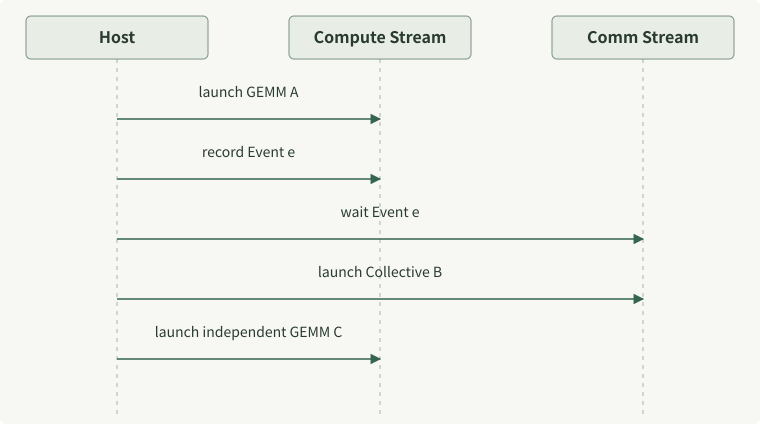

# CUDA Stream、Event 与异步执行

CUDA Kernel 启动通常是对 CPU 异步的。Stream 表达有序的设备工作队列；不同 Stream 的工作可能并发，但需要数据依赖、设备能力与资源预算都允许。多个 Stream 不等于自动获得重叠。

## 提交、等待与可见性

B 只能在 A 完成后读取其结果。独立的 C 可与 B 重叠；若 C 依赖 B，则 Compute Stream 还必须等待相应通信完成信号。CPU 提交顺序不能替代跨 Stream 的设备依赖。

在 PyTorch 中可以用 CUDA Event 计时一个已预热的 Stream 区间：

~~~python
import torch

a = torch.randn(2048, 2048, device="cuda")
b = torch.randn_like(a)
for _ in range(5):
    c = a @ b
start = torch.cuda.Event(enable_timing=True)
end = torch.cuda.Event(enable_timing=True)
start.record()
for _ in range(20):
    c = a @ b
end.record()
end.synchronize()
print(start.elapsed_time(end) / 20)
~~~

这段示例需要 CUDA 环境，未给出实测结果。它统计的是该 Stream 区间的设备经过时间，不自动代表多 Stream 的端到端关键路径。逐算子调用全局 synchronize 会消除原本可用的异步性。跨 Stream 使用 Tensor 还需确保其存储生命周期，不只保证计算顺序。

## 重叠与 Graph

假设 A=4ms、B=3ms、C=5ms，A 后 B 与 C 无依赖且可完全重叠，关键路径是 4+max(3,5)=9ms，而串行为 12ms。实际并发争抢 SM、HBM 或网络，耗时可能变化，不能直接取理想 max 当实测。

CUDA Graph 捕获并重放操作图，降低 CPU 重复提交和 launch 的开销。图中仍可包含多个独立 Kernel。地址、Shape、控制流、同步方式与动态数据更新必须满足对应实现的捕获约束。推理引擎常按不同 batch 规模准备图；不满足条件时可能回退普通执行。

参考：[CUDA Programming Guide](https://docs.nvidia.com/cuda/cuda-programming-guide/index.html)、[PyTorch CUDA semantics](https://docs.pytorch.org/docs/stable/notes/cuda.html)、[Nsight Systems](https://docs.nvidia.com/nsight-systems/UserGuide/)。
