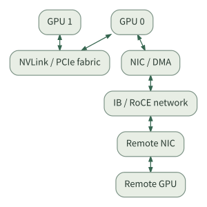

# PCIe、NVLink、RDMA 与集群通信

Collective 是逻辑通信操作，不代表固定硬件路径。跨两块 GPU 的数据可能经过 NVLink/NVSwitch，也可能经 PCIe；跨节点则还涉及 NIC、网络交换与远端 GPU/Host 的数据可见性。

## 数据路径

图中是支持直接 DMA 时的一种可能路径。PCIe 和 NVLink 是节点内设备互联技术；InfiniBand 与 RoCE（RDMA over Converged Ethernet）是网络方案。RDMA 指跨机器内存访问机制，并非某种固定带宽的线缆。GPUDirect RDMA 在受支持的拓扑、驱动与内存注册条件下允许 NIC 对 GPU 内存直接进行 DMA，避免某些 Host staging；仍需控制面协作、传输与同步。

## 从字节到延迟

简化单条链路模型 $T\approx \alpha + S/BW$。同样 64 MiB 数据，假设 A 链路有效 100 GB/s、B 链路有效 25 GB/s，纯传输下界分别约 0.671 ms 和 2.684 ms。不包括启动时延、协议、拥塞及多跳影响。Ring All-Reduce 还需按通信算法计算每 Rank 实际发送量，不能用 64 MiB 直接代替。

当 4 Rank 共用一条 NIC 或 PCIe 上行链路，多个传输的带宽未必能相加到各自理论值。NUMA、PCIe Root Complex、NIC 与 GPU 的亲和性、rail 分布都会改变真实路径。区分标称双向带宽、单向有效带宽和集体通信的算法带宽。

## 工程观测

用 nvidia-smi topo -m 查看节点内拓扑，再核对 Rank 到 GPU、NIC、节点的映射。通过 NCCL 日志和相应的 nccl-tests 在目标消息大小、dtype、通信组上比较节点内与跨节点耗时；对照真实 Timeline 检查是否有拥塞、启动等待或 straggler。链路能力要在目标机器上验证，不能从某个 GPU 型号推断集群一定具备 NVSwitch 或 RDMA。

继续阅读 [NCCL 与 Collective](distributed-collectives.md)。参考：[NVIDIA GPUDirect RDMA](https://docs.nvidia.com/cuda/gpudirect-rdma/index.html)、[NCCL User Guide](https://docs.nvidia.com/deeplearning/nccl/user-guide/docs/index.html)。
