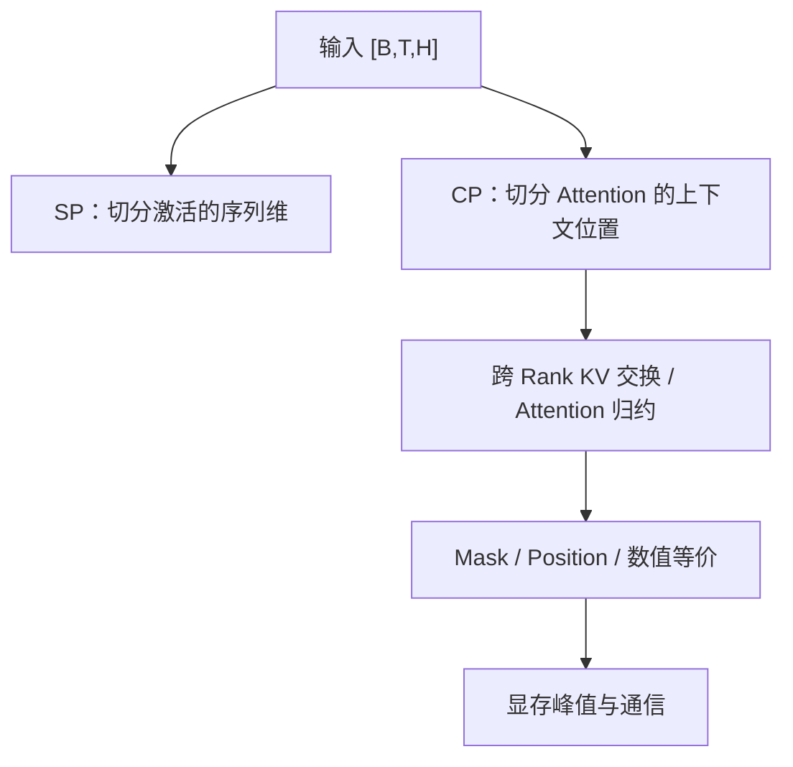

# 长上下文为什么不能只靠增加 TP？

TP 拆 Hidden/Head 维度，长序列 Attention 的瓶颈却可能是按序列增长的激活和 KV；即使权重已经放得下，单卡仍可能在 Attention 处 OOM。

## 统一锚点

B=1，T=65536，H=4096，32 个 Query Head，Head Dim=128，BF16，CP=4。一个完整 `[1,65536,4096]` 激活张量为 512 MiB；均匀按序列切分后每 Rank 128 MiB（不含复制/缓冲）。如果 K/V 头数也为 32，则单份 K 或 V 同样 512 MiB；如果是 GQA 且 KV Head=8，则单份 K 或 V 仅 128 MiB。**不能把 Q Head 数直接代入 GQA 的 KV 大小。**

## SP 与 CP 不是一个东西

**SP 的目的**通常是减少 TP 相关的激活冗余，在部分算子边界以 Sequence Shard 保存张量，必要时通过 All-Gather/Reduce-Scatter 切换布局；它并不自动解决长上下文 Attention 的全部 KV 依赖。

**CP 的目的**是让不同 Rank 负责不同 Context 位置的 Attention 计算/存储。因果 Attention 中，当前位置只能关注不晚于自身的位置；每个 Rank 计算本地 Query 时，需要访问合法的远端 KV，可能通过 Ring/P2P 或其他通信实现。Attention 的归一化需要稳定合并各分块的 softmax 统计量，不能直接平均各块输出。

**关键不变量**：分布式结果与单卡完整因果 Attention 在数值容差内一致；RoPE/Position ID 必须对应全局 Token 位置；Mask 不得泄漏未来 Token。

## 成本模型

标准 Attention 算术复杂度为 `O(B T² H)`（忽略常数和 Head 布局），FlashAttention 主要优化中间显存访问与存储，不会让全 Attention 的算术复杂度自动变成线性。CP=4 可分担本地 Query 计算和局部 KV 存储，但需要交换 KV；通信量依实现和因果优化而变，不能简单宣称缩短 4 倍时间。

| 对象 | 锚点尺寸 | 计算/存储位置 | 观测 |
|---|---|---|---|
| activation | 512 MiB 全量，128 MiB/CP4 | Transformer Block | peak HBM |
| K（MHA） | 512 MiB 全量 | Attention/KV | KV 通信字节 |
| K（GQA8） | 128 MiB 全量 | Attention/KV | KV Head 配置 |
| attention output | [1,65536,4096] | 分块合并 | max error、NaN |
| position IDs | [1,65536] | RoPE/Mask | 分片全局偏移 |

**实现阅读入口**：Megatron Core Context Parallel、Sequence Parallel、Attention Backend；观察 `context_parallel_size`、`sequence_parallel`、TP/CP Process Group、KV Exchange 和重计算。实现行为需按选定版本源码核实。

**排障**：CP=4 仍 OOM → 区分 Activation、KV、通信缓冲与重计算；结果偏差 → 先检查全局 Position/Mask，再查 softmax 分块合并；CP 越大越慢 → 查看 KV Exchange、拓扑和 Rank 不均衡。

三个验证：短序列完整 Attention 对照 CP1/2/4；MHA 与 GQA 的 KV 字节核算；固定模型/Batch 逐步增大 T，记录 Peak HBM 与通信耗时。

参考：[Megatron Core](https://docs.nvidia.com/megatron-core/developer-guide/latest/index.html)。
