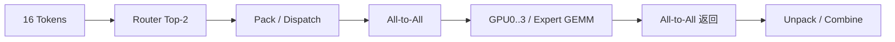

# MoE Expert 分到多张 GPU，为什么 All-to-All 反而成了瓶颈？

设 4 张 GPU，每张负责 2 个 Expert，总计 8 个 Expert；一个 Batch 有 16 个 Token，每个 Token 选择 Top-2 Expert。理想均衡时总共 32 次 Expert Assignment，平均每个 Expert 4 个 Token。但 Router 可能把大量 Token 送往同一 Expert，平均值并不能代表最慢 Rank。

**直觉**：EP 切的是 Expert 参数，而不是自动把 Token 均匀切开。**不变量**：每条 Assignment 的 Token ID、Expert ID、Router 权重与原始位置必须在 Dispatch/Combine 前后对应；不平衡是路由结果的性质，不一定是通信实现错误。

## 通信与长尾

每个 Token 的 Hidden=4096、BF16，则一个激活向量 8 KiB。Top-2 对 16 Token 产生 32 个 Assignment，若全部跨 Rank，单向 Dispatch 载荷上界示意约 256 KiB，返回同量级；真实本地命中、压缩/打包、拓扑和并行策略会改变字节量。假设某 Expert 收到 14 个 Token 而其他 Expert 只收到 2–4 个，最慢 Rank 的 Expert GEMM 和等待可能主导整个 MoE Layer 延迟。

## 实现路径与数值问题

Megatron Core MoE Token Dispatcher、Grouped GEMM、Expert Parallel Process Group 是代码阅读入口。记录 `tokens_per_expert` 分布、`max/mean`、All-to-All 时长、Token Packing 时间、Expert GEMM 时间和丢弃/容量策略（若有）。

| 对象 | 形状/单位 | 位置 | 要检查什么 |
|---|---|---|---|
| topk_indices | [16,2] | Router | Expert ID 是否稳定 |
| topk_weights | [16,2] | Router | 归一化与 dtype |
| dispatch buffer | 32×4096 元素上界示意 | Pack/All-to-All | 发送量和本地命中 |
| expert_load | 8 个计数 | Expert GEMM | max/mean、尾部等待 |
| combined output | [16,4096] | Combine | 与参考实现误差 |

**训练/推理差异**：训练还要回传 Expert Gradient、做 Expert 参数更新；推理的 Token 数随 Decode Batch 变化，可能出现小批量 All-to-All 启动开销。RL 训推不一致还可能来自 Expert Assignment 漂移；R3 类 Router Replay 只能针对离散路由一致性，不能自动修复全部数值差异。

排障路径：**吞吐波动** → 看每个 Step 的路由直方图与最慢 Rank；**NCCL All-to-All 长尾** → 查实际跨节点 Token 流量与负载；**输出漂移** → 固定 Router Top-k、权重与 Token 顺序做单卡参考对照。

**三个对照**：均匀 Router vs 热点 Router；EP=1/2/4；固定 Expert Assignment 对比训练与推理输出。

**交互图规格**：左侧 Token、中央 Expert、右侧 GPU；切换“均衡 / 热点”路由分布，连接线随 Token 目的地变化，显示每卡 Token 计数和最慢 GPU；不要让动画暗示路由一定均衡。

参考：[Megatron Core](https://docs.nvidia.com/megatron-core/developer-guide/latest/index.html)。
