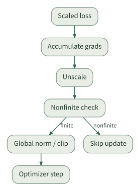

# Loss Reduction、梯度范数与更新一致性

比较两个训练实现是否等价，应比较同一逻辑 Batch、同一 Loss Reduction 下的梯度和更新后参数，而不只是 Loss 标量。物理 Rank 布局变化后，分母与梯度统计所有权仍需一致。

## 全局范数与重复副本

设一个逻辑梯度向量 g=[3,4]，L2 norm=5。若参数在两 Rank 上各完整复制，两个 Rank 都参与平方和并得到 50，再开方会误得 7.071。若 g 真实分片为 Rank0=[3]、Rank1=[4]，则 9+16=25 正是正确的平方和。

$$
\lVert g\rVert_2=\sqrt{\sum_{i\in\text{unique logical elements}} g_i^2},\quad
g' = g\min(1,M/\lVert g\rVert_2).
$$

取 max_norm=2，正确缩放系数为 0.4，得到 [1.2,1.6]。重复计数则会把梯度压得更小。这里忽略实现防除零的 epsilon；零范数无需放大。TP、DP、FSDP、共享参数/alias 的布局决定谁参与 norm，不能直接对整个 world 的所有本地 .grad 求和。普通单进程 clip_grad_norm_ 的 API 不自动理解任意自定义分布式参数归属。

## 混合精度的操作顺序

该图表示采用 loss scaling 的一种逻辑顺序。梯度累积期间 scale 应保持一致；在全部待更新梯度完成后 unscale，再按未缩放值做范数和裁剪。若跨 Rank 分片组成一次逻辑更新，必须达成一致的成功/Skip 决策，否则模型和 Optimizer State 可能分歧。实际框架的 API、同步点和 scaler 状态处理以版本实现为准。

## Mask 与静默异常

设梯度或中间结果含 NaN，把它乘以 0 仍可能得到 NaN。因此无效位置的 mask 不是安全执行非法计算的许可。例如先对 [1,0] 做除法再屏蔽第二个值，Autograd 图已经包含除零。应在除法、log 或归一化前构造合法输入，或只计算有效元素；全零有效 Token 的 Batch 需要明确定义是跳过更新还是执行其他逻辑，不能除以零。

固定一批样本和初始参数，比较单卡与不同分片/累积方案的有效分母、逻辑梯度、norm、clip 系数、Skip 决策、更新后的参数及优化器状态。对浮点误差使用有依据的容差；不能要求任意 Kernel、设备和版本跨环境 bitwise 相同，也不能把大偏差用容差掩盖。

参考：[PyTorch clip_grad_norm_](https://docs.pytorch.org/docs/stable/generated/torch.nn.utils.clip_grad_norm_.html)、[AMP Examples](https://docs.pytorch.org/docs/stable/notes/amp_examples.html)、[Autograd mechanics](https://docs.pytorch.org/docs/main/notes/autograd.html)。
