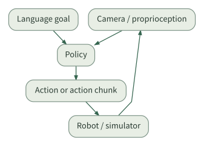

# VLA、连续动作策略与 World Model

VLA 解决从视觉、语言和机器人状态到动作的问题；World Model 试图预测环境在给定动作下的未来状态或观测。前者是策略，后者是环境动力学的近似。模型可以同时包含两者，但二者训练目标与使用位置不同。

## 动作空间与模仿学习

假设机械臂每步动作有 7 个维度，控制频率 20 Hz。一段 8 步 Action Chunk 的 Shape 为 [8,7]，覆盖 0.4s 的计划时间。实际闭环可每次仅执行其中一部分，再获取新观测并重规划。块更长可能减少模型请求次数，但不必然提高成功率，控制延迟与环境变化必须计入。

离散 VLA 可以对连续动作分箱并映射为 Token，再训练自回归概率；连续策略可直接回归动作或建模条件动作分布，例如 Diffusion/Flow Head。Behavior Cloning 使用演示中的 observation/action 对学习策略，不需要环境在线 Reward；部署时策略可能遇到演示未覆盖的状态，发生误差累积。

OpenVLA 是开放的 VLA 实例；pi_0 的论文则提出基于预训练 VLM 的 Flow Matching 机器人控制方案。不能把这些模型的所有训练方式称为 RL，也不能把 Flow 动作策略的 MSE 直接解释成离散 Token Logprob。

## World Model 与 Model-based RL

设状态是物体的一维位置 z，动作 a 表示移动量。一个简化真实环境转移是 z_next=z+a，模型估计为 z_next=z+0.9a。从 z=0 连续十次执行 a=1，真实状态为 10，模型预测为 9。模型误差会在多步想象中累积；策略可能利用近似模型中的漏洞而非真实环境动力学。

World Model 可预测像素、潜变量、奖励或终止信息。Model-based RL 可以用模型生成想象轨迹或用于规划，再用真实数据校正。DreamerV3 是学习世界模型并通过想象改进策略的代表。视频生成模型如果仅学习视觉分布、缺乏动作条件和可验证的状态转移，不应直接称为完整可控的 World Model。

具身数据需要标注时间、动作坐标系、机器人形态、标定与 episode 边界。实际评估应比较任务成功率、控制延迟、失败类型和真实/模拟环境差距。动作密度与信用分配需要根据策略和控制时间尺度定义；这就是它与普通文本 Rollout 的基础区别。

参考：[OpenVLA](https://arxiv.org/abs/2406.09246)、[pi_0](https://arxiv.org/abs/2410.24164)、[DreamerV3](https://arxiv.org/abs/2301.04104)。
