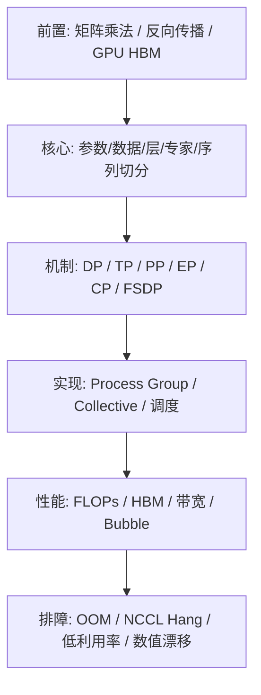
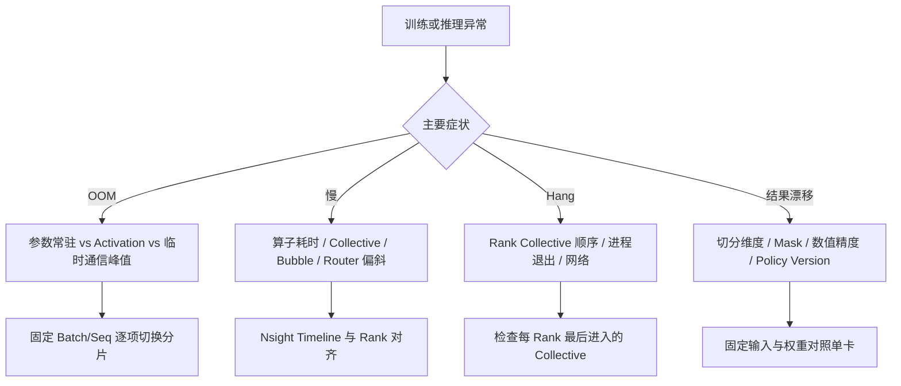

# 一张 GPU 放不下模型：从矩阵切分到分布式训练与推理

当模型或上下文超出单卡容量时，增加 GPU 只是提供了资源，**如何切分状态、计算和通信**才决定能否运行、是否加速。先看一个贯穿全文的例子，再把 DP、TP、PP、EP、CP、FSDP 放到同一张成本图上。

## 知识依赖图

学习路径：先掌握 TP、DP 和通信原语；再理解 PP、EP、CP、FSDP；最后结合 Megatron、SGLang、vLLM 和 RL 训推分离讨论选型。

## 贯穿示例：8 张 GPU、一个 Transformer MLP

取输入 `X: [4, 4096]`，第一层权重 `W1: [4096, 8192]`，第二层 `W2: [8192, 4096]`，BF16 每元素 2 字节。仅 W1 有 33,554,432 个参数，恰好 64 MiB；W2 同样 64 MiB。假设 8 张 GPU、单卡有效通信带宽 100 GB/s（**演示假设，不是硬件实测**）。

未分片时两层权重共 128 MiB；如果 TP=4，按适当维度切分后，每卡两层权重共约 32 MiB。注意这里只算两个矩阵，训练总显存还包含梯度、优化器状态、激活、临时通信缓冲；真实 Transformer 还包含 Attention、Embedding 等。

### TP：一层矩阵怎样拆给多张卡？

**直觉**：把 W1 按输出列分成四份，每张卡算 `Y_i=XW1_i`，局部输出形状 `[4,2048]`。四份拼接才是数学上的完整 `[4,8192]`，但下一层如果恰好是 Row Parallel，就可以保持分片，避免中途聚合。

**不变量**：`concat(XW1_i, dim=-1) == XW1`（容许浮点舍入）；Row Parallel 把输入与 W2 的输入行对应切开，各卡计算 `Z_i=Y_i W2_i`，再对 `Z_i` 求和，恢复 `[4,4096]`。**Column Parallel 的输出不是每层都必须 All-Gather**；Row Parallel 的部分和也不是拼接。

**机制与成本**：W1 每卡权重 16 MiB，W2 每卡 16 MiB；忽略 Bias 和非线性，两个 GEMM 的总 FLOPs 约 `2×2×4×4096×8192=5.37e8`，理想均分到四卡约 `1.34e8` FLOPs/卡。Row Parallel 结果大小 `4×4096×2=32768 B`；Ring All-Reduce 每卡理论传输量约 `2(p-1)/p×32768=49152 B`（p=4），纯带宽下界约 0.49 微秒，**不包含启动延迟、实际算法和拓扑**。小张量通常更受启动延迟影响。

**代码映射**：Megatron Core 常见 `ColumnParallelLinear` / `RowParallelLinear`；检查 `tensor_model_parallel_size`、Process Group、是否保持输出分片，以及 Forward/Backward 的 Collective。对齐单卡参考值，记录每层局部 Shape、All-Reduce 次数与耗时。

**失败与验证**：TP 增大后变慢→先对照 GEMM 时间和 NCCL Timeline；数值不一致→核对 Row/Column 切分维度和 Bias；OOM→查临时 Buffer/激活而不只看参数。先用 TP=1/2/4 固定输入做数值等价实验，再跑性能测试。

一个快速判断：如果把 TP 从 2 提到 4，计算理论减少了，但通信从节点内变成跨节点，吞吐一定提升吗？**不一定**，必须比较关键路径和互联带宽/延迟。

### DP / DDP：为什么模型不够放时，增加 DP 不能救场？

**直觉**：每张 GPU 放一份模型，处理不同样本。**不变量**：同步更新前，各副本聚合后的梯度应对应约定的全局 Batch 归约方式；梯度平均与 Loss Reduction 必须匹配。

**机制**：各 Rank Forward/Backward 后按 Bucket All-Reduce 梯度；模型参数与优化器状态仍按副本完整存储。若有 P 个参数、BF16 梯度，Ring All-Reduce 的每卡近似字节量为 `2(P-1)/P × 2×参数量`，不含协议开销。注意 DDP 可能与 Backward 重叠通信。

**实现**：PyTorch DDP 的 Bucket、`no_sync`、Process Group；记录 global/micro batch、梯度归约时机、Bucket 时间。**故障**：Loss 与单卡不符→检查归约/梯度累积；NCCL Hang→检查不同 Rank 的 Collective 顺序与未使用参数；慢→看 Bucket overlap。验证时锁定有效 Global Batch 与随机种子。

### PP：为什么层分到不同 GPU 还会有空闲？

**直觉**：不同 GPU 持有不同层，Micro-batch 像流水线依次经过 Stage。**不变量**：前向激活与反向梯度按相同样本和 Stage 边界匹配；更新不能破坏权重版本约定。

**机制**：简单同步流水线的 Bubble 近似比例 `(p-1)/(m+p-1)`，其中 p 为 Stage 数、m 为 Micro-batch 数（针对理想化排程，具体调度不同）。例如 p=4、m=8，约 27.3%。增大 m 可降低 Bubble，但增加激活存储/调度开销，不能无限增大。

**实现**：Megatron PP/Virtual PP、1F1B 与 Interleaved 调度；检查 Stage 层数均衡、P2P Activation、Micro-batch 数。**故障**：GPU 利用率呈阶梯状→看 Bubble；某 Stage 拖慢全部→统计每 Stage 耗时；OOM→检查 Inflight Activation 与重计算。先绘制真实 Nsight Timeline 再改 m。

### EP：为什么 MoE 的 Expert 分开以后还会堵？

**直觉**：每个 Token 按 Router 选择 Expert；Expert 不在本卡时，要把 Token 发过去。**不变量**：Dispatch 与 Combine 必须保持 Token 索引、权重及顺序映射正确；Expert 负载不一定均衡。

**机制**：Router → Top-k → Token Pack → All-to-All → Expert GEMM → All-to-All → Unpack/Combine。通信体量随路由 Token 数、Hidden Size、dtype 和跨 Rank 位置变化；热 Expert 会形成尾部等待。EP 不等于 TP，常与 DP/TP 组合。

**实现**：Megatron MoE Dispatcher / Expert Parallel，观察 per-expert tokens、capacity/drop、All-to-All 耗时、Grouped GEMM。**故障**：某 Rank 长尾→核对路由直方图；训练/推理概率漂移→检查 Expert 选择、数值与版本；OOM→查局部 Token 峰值。验证用固定 Token/Router 输出复现。

### CP / SP：长上下文与激活切分到底有什么不同？

**直觉**：CP 让多个 Rank 分担序列位置及 Attention 所需 KV 访问；SP 通常指在特定 TP 算子边界按序列维度分布激活，降低激活冗余。二者不是同义词。

**不变量**：因果 Attention 不能看到未来 Token；分布式 Attention 聚合必须等价于完整序列的合法 Attention。**机制**：CP 可通过 Ring/P2P 或 All-Gather 类通信交换 KV/部分结果；注意计算量通常随上下文长度平方增长（标准全 Attention），FlashAttention 改变中间存储复杂度而非这个算术量级。

**实现**：Megatron Context Parallel / Sequence Parallel，关注 `context_parallel_size`、`sequence_parallel`、Attention Backend 和通信拓扑。**故障**：长上下文 OOM→区分 KV/激活/临时 Buffer；CP 增大后慢→看 KV 交换与负载；输出不符→检查 Causal Mask 与位置编码分片。用短序列单卡参考做逐 Token 对照。

### FSDP2 / ZeRO：参数分片为何仍会出现峰值？

**直觉**：参数、梯度、优化器状态不必始终完整驻留每张卡。**不变量**：参与算子计算时需要正确的参数视图；反向的梯度分片和优化器所有权必须一致。

**机制**：典型 FSDP2 在模块计算前 All-Gather 参数，反向后 Reduce-Scatter 梯度；峰值还取决于预取、模块边界和 Activation。与 TP 不同，FSDP 主要改变参数状态生命周期，而非必然把单个 GEMM 拆成多卡共同计算。

**实现**：PyTorch `fully_shard`、DeviceMesh、Reshard 策略；对照 DeepSpeed ZeRO 的状态分片阶段（不同版本配置不同）。**故障**：常驻显存低但 Forward OOM→抓 All-Gather 峰值；Hang→检查 Collective 顺序；性能倒退→查预取/重分片次数。优先做单模块显存曲线。

## 从训练到推理：同一个 TP 数字，含义为何不完全相同？

训练需要 Forward、Backward、梯度同步与优化器状态；推理通常只有 Forward，但 Decode 受小 Batch、KV 访问、Collective 延迟约束。SGLang/vLLM 中 TP 常用来分摊权重与 Attention/MLP 算子，DP 主要增加独立服务副本；请求调度、Paged/Radix KV Cache、Prefill/Decode 分离会改变实际瓶颈。MoE 的 EP 还要考虑 Token 路由与请求并发。

**RL 训推协同**：训练 TP=2、推理 TP=8 可能合理，因为 Learner 和 Rollout 的 Batch、Sequence、算子、KV/Optimizer 状态完全不同；但权重广播、重分片、GPU 资源交接和策略版本会产生额外成本。不要直接用训练引擎的并行配置推导推理引擎的最佳配置。

## Math → Code：调试时该记录什么？

| 数学对象 | 典型 Tensor/单位 | 发生位置 | 必查指标 | 常见错误 |
|---|---|---|---|---|
| `XW_i` | `[4,2048]` BF16（TP4） | Column GEMM | local shape、kernel 时间 | 切分轴错误 |
| `Σ_i Y_iW2_i` | `[4,4096]` BF16 | Row GEMM + Reduce | All-Reduce 次数、bytes | 错当 concat |
| `∇W` | 参数对应梯度 | Backward / DDP | Bucket/Reduce 时间 | 重复平均 |
| `A_stage` | micro-batch activation | PP send/recv | Stage stall、peak HBM | Micro-batch 不匹配 |
| `tokens_per_expert` | int/count | MoE Router | P50/P99、最大负载 | 热点 Expert |
| `K,V` | `[B,heads,T,dim]` 变体 | CP/Serving | KV bytes、传输时间 | Mask/位置错位 |
| `sharded_param` | DTensor shards | FSDP2 | All-Gather 峰值 | 只估常驻显存 |

## 选型时先算的成本

- **权重**：`N_params × bytes_per_param / shard_factor` 仅是参数项；不要用它代替总 HBM。
- **训练状态**：分别统计 Master Weight（如有）、Optimizer Moment、Gradient、Activation、All-Gather/通信 Buffer，区分常驻与峰值。
- **通信**：理论下界 `T >= bytes / effective_bandwidth`，实际还包括启动延迟、同步等待和拓扑拥塞。
- **关键路径**：不能把有重叠的 CUDA Kernel 与 NCCL 耗时简单求和；以 Trace 中的真实依赖为准。

## 排障树

三个最小实验：① TP=1/2/4 的前向数值等价、局部 Shape 与通信次数；② PP=2/4 固定总 Batch、改变 Micro-batch 并验证 Bubble 估算；③ EP 固定 Router 索引、注入不均衡分布并观察 All-to-All 长尾。

## 继续深入的路线

从 **TP 的完整 Forward/Backward 通信** 开始，随后是 **PP 时间线**、**MoE EP Token Dispatch**、**CP Attention/KV 交换**，最后进入 **Megatron × SGLang/vLLM × RL 训推并行配置**。建议做一个小型并行策略计算器：输入模型层数/Hidden/Expert/Seq、GPU 拓扑和并行度，输出各 Rank 的权重占用、理论通信字节与需要实测的关键路径，明确不将理论估算冒充真实性能。

### 官方参考

- [Megatron Core](https://docs.nvidia.com/megatron-core/developer-guide/latest/index.html)
- [PyTorch FSDP2](https://docs.pytorch.org/docs/stable/distributed.fsdp.fully_shard.html)
- [PyTorch DDP](https://docs.pytorch.org/docs/stable/generated/torch.nn.parallel.DistributedDataParallel.html)
- [SGLang](https://docs.sglang.ai/)
- [vLLM](https://docs.vllm.ai/)

> 本文数值均为示例推导，不代表已在特定硬件/框架版本跑通。涉及源码 API 的具体行为需要按目标版本核验。
