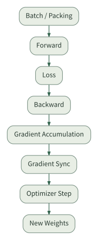

# 从 DataLoader 到 Optimizer Step

一次逻辑更新不是一次 Forward。训练读取数据、计算目标、累积梯度并在约定边界更新参数。Pretraining 与 SFT 通常共享 Causal LM 计算主干，差别在数据和监督 mask；RL 则额外依赖采样、奖励和概率契约。

## 单次更新的运行顺序

图中同步表示逻辑依赖；DDP 可以在反向过程中按 Bucket 启动通信。标准 DP/DDP 让不同 Rank 保存完整模型副本并处理不同数据；DDP 同步梯度，不自动划分 Dataset，也不分片参数或 Adam 状态。FSDP、ZeRO 的状态分片是另外的机制。

若每个 DP Rank 的 micro-batch 有 2 个序列，累积 4 次，DP size=8，则在等量数据、一次更新完成条件下 global batch=64 个序列。TP/PP Rank 合作处理同一组样本时，不能再乘 TP/PP。变长训练还要统计有效 Token。

## 梯度的有效分母

两个 Microbatch 分别有 1 与 3 个有效 Token，每 Token 对某一参数的梯度贡献分别为 [4]、[0,0,0]。全局 token mean 梯度为 (4+0)/4=1；各 Microbatch 先求均值再平均是 (4+0)/2=2。两者都可能正常执行 Backward，但逻辑更新不同。

默认等权 DDP 梯度平均下，若希望所有 Rank 按全局有效 Token 数 N 归一化，可在每 Rank 构造本地 loss sum × p/N（p 为参与该 DDP 组的 Rank 数），再由 DDP 平均。这里要求正确统计该逻辑数据并行组的 N、所有 Rank 参与一致归约，且无其他重复平均。框架若采用 SUM、定制 Hook 或不同并行组需重新推导。

## Optimizer 与持久化

SGD 更新 $w'=w-\eta g$；Adam 类方法维护一阶与二阶矩估计，使用偏差修正后的一阶矩除以二阶矩平方根与 epsilon。AdamW 的 Weight Decay 与自适应梯度更新解耦。

假设 BF16 参数、BF16 梯度、独立 FP32 master weight 和两个 FP32 moment，单参数理想载荷为 2+2+4+4+4=16 B；1B 参数约 16 GB。实际实现可能无 master weight、使用不同梯度 dtype、状态分片或延迟初始化，因此不可把 16 B 当成所有框架固定预算。

Checkpoint 恢复若只加载模型权重，会丢失 optimizer、LR scheduler、随机状态、数据位置等训练状态。对 RL 还需考虑已发布策略版本和在途轨迹。保存时要确定逻辑提交点，不把正在更新的参数与上一时刻的 optimizer state 混在同一个一致性快照中。

继续阅读 [并行拓扑](parallel-topology.md) 与 [状态分片](training-sharding.md)。参考：[PyTorch DDP](https://docs.pytorch.org/docs/stable/generated/torch.nn.parallel.DistributedDataParallel.html)、[AdamW](https://docs.pytorch.org/docs/stable/generated/torch.optim.AdamW.html)、[Checkpoint](https://docs.pytorch.org/tutorials/recipes/recipes/saving_and_loading_a_general_checkpoint.html)。
