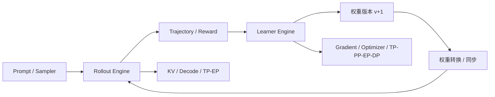

# 16 张 GPU 做 RL：Learner 和 Rollout 应该怎么分？

RL 的 GPU 不只训练模型，还要生成 Token、算 Logprob、执行 Reward/Verifier、同步权重。把训练引擎的 TP/PP/EP 配置原样复制给推理引擎，常常不是最优解。

## 统一例子：2 节点 × 8 GPU

假设 Learner 的 Dense 层使用 TP=2、PP=2、DP=4，满足 TP×PP×DP=16；MoE 层再配置 EP=4 时，需要从现有 Rank 中构建 Expert Parallel Group，并相应调整 Expert Data Parallel Group，**不是再乘 4**。Rollout 可使用 TP=4、DP=4，共 16 GPU。两个 Engine 的分组、参数布局与通信模式并不相同；真实组合是否支持必须按目标 Megatron/SGLang 版本及 Parallel Group 初始化核验。

## 第一步：分别建立容量约束

Learner：`M_peak = M_param + M_grad + M_optim + M_activation + M_comm + M_temp`；参数和 Optimizer 的分片因子、Activation Checkpoint、Micro-batch、Sequence Length 会改变峰值。

Rollout：`M_peak = M_weight + M_KV + M_workspace + M_cuda_graph + M_temp`。KV 按层数、KV Head、Head Dim、上下文长度、并发数计算，不能用模型参数量代替。推理还需要核对 Max Running Requests、Prefix Cache、Speculative Decoding。

## 第二步：比较关键路径

同步 RL Step 可近似分解为 `T_step = T_rollout + T_score + T_logprob_adv + T_train + T_weight_sync + T_drain`，但若阶段重叠，需要使用 DAG 的最长路径，而不是简单求和。异步情况下还要衡量 Policy Staleness、在途样本排空与数据选择偏差；提高吞吐不一定改善训练质量。

**权重更新**：训练与推理的 TP/EP 不同，需要从训练分片映射到推理分片。模型权重总字节数只是下界，还要考虑跨节点传输、格式转换、加载与 GPU 暂停窗口。版本标签应说明实际用于生成每段 Token 的 Policy，而不是只记录轨迹完成时刻。

## 可操作的选型表

| 约束 | Learner 优先考虑 | Rollout 优先考虑 |
|---|---|---|
| 参数/Optimizer OOM | FSDP2/ZeRO、TP、PP | TP、EP、Weight Quantization |
| 长序列训练 | CP、SP、Activation Recompute | KV 分片、Prefix Cache、PD |
| MoE Expert 大 | EP + TP 组设计 | EP + DP Attention/Batch |
| 跨节点通信昂贵 | 尽量让高频 TP Collective 留节点内 | 减少 Decode 每 Token 跨节点同步 |
| 长尾严重 | Micro-batch、Stage Balance | Admission、Agent/Sandbox 并发、Partial Rollout |
| 更新频繁 | Gradient/Optimizer 通信 | Weight Transfer、Version/Drain |

## 工程实现与诊断

VERL/HybirdFlow 的 Worker/Rollout 边界、Megatron Core 的 Parallel Group、SGLang 的 Serving Scheduler 和 Weight Update 接口是阅读入口；具体方法签名与支持能力必须按仓库 Commit 核验。建议记录 `train_version`、`rollout_version`、每段 Token 的 Behavior Policy（若跨更新）、GPU 时间、权重同步耗时、有效训练 Token 数、P99 TBT、Step Drain 时间。

**故障树**：Rollout GPU 空转 → 查 Sandbox/Verifier 与 Admission，而不是立刻增大 TP；Learner OOM → 拆开 Optimizer/Activation/Comm；权重同步过慢 → 看源/目标分片布局与跨节点传输；Logprob Drift → 排除 Sampling/Mask/Version/Router 后再查精度。

三个最小实验：① 固定 16 GPU，比较不同 TP×DP Rollout 组合的吞吐和 P99；② 固定有效 Batch，对照 Learner TP/EP 分组和 NCCL 时间；③ 记录一次完整权重更新的版本、字节、时间与 rollout 停顿，并核对生成 Token 的版本。

**注意**：本文是架构与实验方法，不代表某一配置在指定 GPU 上已经验证更快。参考：[verl](https://verl.readthedocs.io/)、[Megatron Core](https://docs.nvidia.com/megatron-core/developer-guide/latest/index.html)、[SGLang](https://docs.sglang.ai/)。
