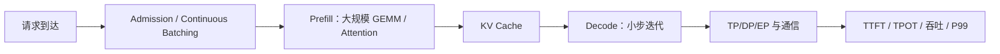

# 训练 TP=8，为什么推理未必也应该 TP=8？

训练在较大 Token Batch 上做 Forward/Backward，推理 Decode 每次通常只追加少量 Token。相同 TP Degree 下，推理每层的小 GEMM 与跨卡 Collective 可能让通信延迟占比更高；而权重能否放下、KV 容量和请求并发又可能要求不同的切分。

## 一个可复算的 KV 锚点

设 32 层、8 个 KV Head、Head Dim=128、BF16、上下文 T=65536，单请求 KV 容量（未做 KV 量化、无滑窗或压缩）约：

`2(K,V) × 32(layers) × 8(KV heads) × 128(dim) × 65536(tokens) × 2(bytes) = 8 GiB`。

这是**一个请求的理论 KV 数据量**，不是引擎真实显存占用。Paged KV 的 Block 元数据、碎片、共享前缀、Sliding Window、不同 Layer KV 布局和并行分片会改变实际峰值。

## 三个并行决策

**TP**：将 Attention Head/MLP 矩阵切分到多卡，减少每卡权重；代价是层内通信。TP 的收益受 GEMM Shape、KV Head 可分性、节点内互联与小 Batch Decode 影响。不能仅凭参数量给出最优 TP。

**DP / Replica**：多个独立副本处理不同请求，适合单副本能装下模型且请求并发足够的场景；副本间通常不需要每 Token 的 TP Collective，但每份副本都需要权重/KV 预算。部分引擎的 DP Attention 与 MoE EP 组合可能有更复杂的拓扑，需按版本确认。

**EP / PP**：MoE Expert 分布在多个 GPU 上，依赖 Router 和 All-to-All；PP 将不同层分布到 Stage，在线请求会受到 Stage 调度、请求长度差异和跨 Stage Activation 传输影响。Prefill/Decode 分离（PD）是**服务阶段与资源池的分离**，不是 PP 的同义词。

## 指标必须拆开

| 指标 | 计算口径 | 对并行策略敏感的因素 |
|---|---|---|
| TTFT | 请求进入系统到首 Token | Queue、Prefill、权重/KV 命中 |
| TPOT/TBT | 相邻输出 Token 间隔 | Decode GEMM、KV、Collective |
| Tokens/s | 单卡/整集群、输入/输出需注明 | 并发、Batch、请求长度 |
| P95/P99 | 指定请求集合的分位数 | Admission、长尾、热点 Expert |
| KV HBM | 按请求/层/Block 统计 | Context、GQA、缓存策略 |

**框架映射**：SGLang 的 Scheduler、RadixAttention/Prefix Cache、TP/DP/EP 相关启动配置；vLLM 的 Engine Scheduler、Paged KV 与 Parallel Configuration。具体配置字段与支持矩阵会随版本变化，本文只给概念边界，不能把某个版本 API 当作永远有效。

**排障树**：TTFT 高 → 分离 Queue/Prefill/Prefix Hit；TPOT 高 → 看 Decode Batch、NCCL、KV 带宽；OOM → 分别核算 Weight、KV、CUDA Graph/Workspace；EP 长尾 → 看 Token Routing 与最慢 Rank；PD 拆分收益不明显 → 检查 KV Transfer 和资源池利用率。

三个验证：固定模型/权重/精度，对照 TP2/4/8 的 Decode P99；固定总 GPU 对照 TP×DP 的请求吞吐与尾延迟；固定 Prompt/Output 长度分布，对照 PD 同池与分池的 GPU 时间与 KV Transfer。没有测量不能声称哪种更优。

参考：[SGLang](https://docs.sglang.ai/)、[vLLM](https://docs.vllm.ai/)。
