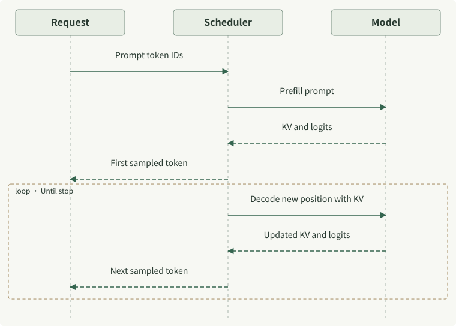

# Prefill、Decode 与实际采样分布

自回归生成每一步都依赖已有前缀。Prefill 将输入上下文送入模型并建立 KV；随后从最后一个有效位置的 logits 采出第一个输出 Token。Decode 利用缓存计算新位置并逐步推进。

## 一条请求的生命周期

假设 Prompt=1024 Token，目标生成 4 Token。常见增量生成路径先 Prefill 1024 个位置并采出第一个 Token，再做 3 次 Decode 来获得其余 3 个 Token；如果实现还要处理最终 Token、计算完整缓存或执行其他动作，调用次数会变化。不能机械把输出长度当成 Decode Forward 次数。

全序列 Prefill 的 Attention 打分涉及大量 Query×Key 位置；Decode 通常只有少量新 Query，但需读取已有的 KV。Batching、缓存复用和 speculative verification 改变每轮处理的形状。详见 [GPU 算术强度](../compute/gpu-execution-memory.md)。

## 从 Raw Softmax 到 Behavior Policy

设原始概率为 [0.6,0.3,0.1]。Temperature=1 时不改变 Softmax；T=0.5 时，若只进行温度变换，归一化平方后得到约 [0.7826,0.1957,0.0217]。若原始分布做 Top-p=0.8，常见 nucleus 规则保留前两个 Token，再归一化为 [2/3,1/3,0]。两次计算各自从原始分布出发；实际组合顺序由采样实现决定。

Greedy 只选择一个最大值（相同最大值时还依赖 tie-breaking）。经过变换的实际采样分布与 raw model distribution 不一定相同。Stop 条件可能截断返回内容；需要明确 EOS、停止字符串及生成后裁剪是否进入记录。RL 若从 q 采样、从 p 优化，就必须记录语义明确的 [Logprob](../learner/logprob-contract.md)。

## 请求调度与指标

假设请求提交时刻 0ms，首 Token 在 80ms 发出，之后三次输出在 100、135、150ms。TTFT=80ms；相邻输出间隔为 20/35/15ms，平均 TPOT=(150−80)/3≈23.3ms（此处假设每次发出一个 Token）。TTFT 包含排队和预处理等开销，不只是 Prefill kernel 时间；多 Token 流式分块需要统一指标定义。

Continuous Batching 在迭代边界调整活跃请求，让已结束请求释放资源、新请求进入。Chunked Prefill 把较长 Prefill 切片，控制与 Decode 竞争的粒度；PD 分离将两个阶段部署到不同执行资源，新增 KV 传输及调度成本。它们解决不同层面的瓶颈。实际优化须同时比较 TTFT、TBT 分布、吞吐、显存与请求成功率。

继续阅读 [KV Cache 与请求调度](kv-scheduling.md)、[推理并行](serving-parallelism.md)。参考：[Hugging Face Generation strategies](https://huggingface.co/docs/transformers/generation_strategies)、[GenerationConfig](https://huggingface.co/docs/transformers/main_classes/text_generation)、[PagedAttention](https://arxiv.org/abs/2309.06180)。
