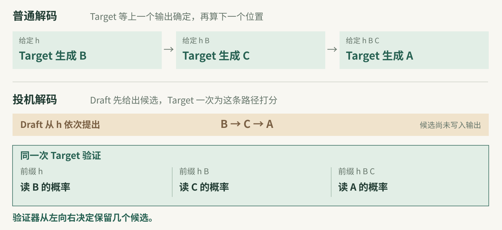
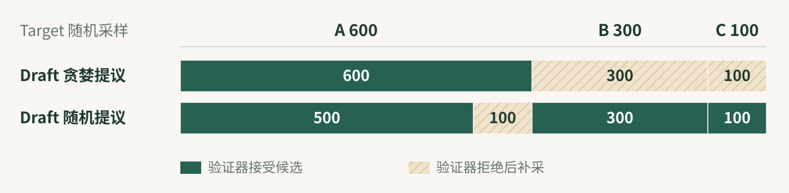
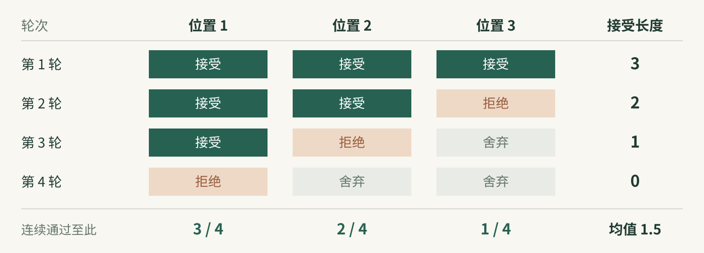

# 投机解码：让大模型一次多走几步

大模型续写“会议定在”时，下一个词可能是“明天”，也可能是“周五”。如果先写了“周”，接下来就该预测“会议定在周”后面接什么。普通的自回归解码就是这样工作的：模型读入已有前文，为下一个 token（词或词的一部分）算出概率，解码程序选出一个，把它接回前文，再算下一步。

这样的依赖决定了生成速度。即使缓存了前文的注意力键和值（KV cache），大模型仍得等上一个 token 确定，才能沿着正确的前缀往下算。在逐 token 解码时，GPU 可能花很多时间读取模型权重，每一趟却只让一条请求往前走一个位置。**如果已经有一份候选续写，大模型能不能一趟多看几个位置？**

投机解码（speculative decoding）就是从这里入手的。把原本负责生成的大模型叫作 Target，再配一个生成成本较低的草稿模型 Draft。Draft 先沿着一条路往下写几个 token。例如，已有前文是 $h$，草稿接着写了 B、C、A。这三个都还是候选。Target 拿到整段候选后，可以在一次验证中同时为几个位置打分。

图 1　上半图画的是普通解码恰好生成 B、C、A 的一次过程。下半图中，同样的三个 token 是 Draft 的提议。方框表示计算依赖，宽度不代表耗时。

为什么现在可以一起算？因为每个位置要读的输入已经有了。Target 要给 B 打分，只读 $h$；要给 C 打分，读 $h$、B；要给 A 打分，读 $h$、B、C。Transformer 的因果掩码让每个位置只能看到它前面的内容，即使整段候选同时送入，也不会偷看到自己要预测的答案。**概率可以并行计算，候选必须从左到右验证。** 如果 B、C 都通过，这一趟就能保留至少两个草稿 token。如果 B 已经被换掉，给 C 和 A 算的分数也就用不上了。

省下的时间来自少等几趟 Target。究竟能省多少，取决于 Draft 花多长时间起草，以及 Target 一趟能留下几个候选。于是有了一个具体的选择：Draft 每步都选自己最有把握的 token，和按自己的概率随机抽取，哪一种能把草稿留得更长？

## Target 把 A 排第一，为什么 B 也能通过

先只看 $h$ 后面的第一个位置。假设词表里只有 A、B、C，两边给出的概率如下。Target 在这个例子中按概率采样，所以它最终要输出 60% 的 A、30% 的 B、10% 的 C。这里的百分比是重复独立采样时的概率，每一次调用都只输出一个 token。

| 在前缀 h 之后 | A | B | C |
|---|---:|---:|---:|
| Target 的目标分布 p | 60% | 30% | 10% |
| Draft 的预测分布 q | 50% | 35% | 15% |

假如 Draft 按 $q$ 抽中了 B，Target 需要做什么？它在 $h$ 的最后一个位置经输出层算出一行 logits，也就是给整个词表打的分。举例说，这行分数可以是 $(\ln 6,\ln 3,\ln 1)$。温度取 1，做 softmax 就得到 (0.6, 0.3, 0.1)。验证器是推理引擎中的一段代码，它取这一行的 B 列，读到 0.30。这个过程中 Target 无需自己先抽一个答案再来核对。

Draft 有 35% 的概率提 B，最终输出只需要 30% 的 B。验证器只要保留所提 B 中的 30/35，就能把两者对齐。落实到一次调用，它独立抽一个 0 到 1 之间的均匀随机数 $u$。若 $u=0.80$，小于 $30/35\approx0.857$，就写入 B；若 $u=0.93$，就拒绝 B。对 A 做同样的计算，草稿提得偏少，提出来的 A 可以全收。

设 $r(x)$ 为 Draft 实际提出候选 $x$ 的概率，通用的接受门槛为

$$
a(x)=\min\left(1,\frac{p(x)}{r(x)}\right).
$$

被拒绝以后该输出什么？把每类 token 经“直接接受”这条路得到的概率列出来，就能看出哪个还缺。

| 概率去向（以所有轮次为分母） | A | B | C |
|---|---:|---:|---:|
| 草稿直接通过 | 50% | 35% × (30/35) = 30% | 15% × (10/15) = 10% |
| 距离目标还缺 | 10% | 0% | 0% |

这里 90% 的轮次直接接受，只有 A 还缺 10 个百分点。所以余下 10% 的轮次，无论拒绝了 B 还是 C，都应补 A。若拒绝后直接按 Target 的原分布重抽，A 最终只有 50% + 10% × 60% = 56%，反倒偏离 60% 的目标。

这也是投机采样能保持目标分布的原因。设 Draft 的实际提议分布为 $r$。对任意 token $y$，能直接保留的概率是

$$
m(y)=\min(p(y),r(y)).
$$

再算每个 token 的缺口 $d(y)=p(y)-m(y)$，把缺口加起来得到 $R=\sum_y d(y)$，恰好等于总拒绝概率，因为所有 $p(y)$ 加起来是 1。发生拒绝时，验证器按 $d(y)/R$ 补采。这样一来：

$$
\Pr(\text{最终输出 }y)
=m(y)+R\frac{d(y)}{R}=p(y).
$$

如果 $R$ 为零，所有提议都通过，程序不会进入补采分支。“无偏”在这里的意思就是给定相同前缀，每个 token 的最终概率与直接从 Target 采样时相同。这个结论对任何实际前缀都成立，把每一步的条件概率相乘，整段序列的概率也就相同。

### 四个 token 的概率线段

拒绝 A 以后，为什么残差里可以没有同样常见的 B？把每个 token 的概率线段单独对齐。下面每格是 0.05，■ 是两边重叠的部分，− 是 Draft 多给的，+ 是 Target 还缺的。

~~~text
         Draft           Target
A .40    ■■■■■■■−        ■■■■■■■   .35
B .30    ■■■■■−          ■■■■■     .25
C .20    ■■■■            ■■■■+     .25
D .10    ■■              ■■+       .15
~~~

A 和 B 各释放 0.05，合起来是 0.10。C 和 D 各缺 0.05，所以**已经发生拒绝时**两者各占残差的一半。B 在直接接受路径已经拿满 0.25；让残差再选 B 会超额。这里的 50% 是拒绝后的条件概率，折回所有轮次是 $0.10\times0.50=0.05$。

如果希望拒绝后能选 B，也可以有另一套无偏方案：把 B 的直接保留量降到 0.20，令 0.15 的总拒绝质量按 B、C、D 各 0.05 分配。输出分布仍一样，但直接保留率从 90% 降到 85%。标准规则取最大重叠，因为每个 token 的直接保留量既不能超过提议量，也不能超过目标量；逐个取两者较小值，所有 token 的直接保留量之和就最大。

残差看的是同一个 token 在两边的差，不看它在词表里排第几。例如 Draft 不变，把 Target 改成 (0.35, 0.38, 0.12, 0.15)，B 虽排第一，仍然差 0.08。它直接通过的概率是 0.30，总拒绝概率为 0.13；补采时 B 占 $8/13$，最终就是 $0.30+0.13\times8/13=0.38$。

## Draft 每次都选 A，会怎样

现在只改 Draft 的选法。它给 A 的分数最高，于是用贪心解码（greedy）每次都选 A。Target 仍按原分布随机采样。两边模型的预测都没变，变化的是验证器分母里的那个数：**Draft 网络给 A 的概率是 50%，Draft 端用了 greedy，实际提出 A 的概率却是 100%。**

验证器保留 A 的概率因此是 $0.60/1=60\%$。一旦拒绝 A，剩下的缺口是 B 的 30% 和 C 的 10%，按 3∶1 补采即可。把这两种 Draft 策略放回同样的 1000 次提议里看，两行最终输出的构成相同，差别都在绿色部分。

图 2　每 1000 次的期望次数。绿色是验证器保留的草稿，斜纹是拒绝后补出的 token。

按概率提议的 Draft 少贡献了 100 个 A，却多贡献了 300 个 B 和 100 个 C，合计多留下 300 个 token。它的接受率达到 90%，因为它提出的候选在三个 token 上都能为目标分布贡献一部分概率。这个比较也说明，两种分布重合得越多，能直接接受的就越多。把每个 token 的 $m(y)$ 相加，就是单步接受率；它也等于 1 减去 $p$ 和 $r$ 的总变差距离：

$$
\Pr(\text{accept})=\sum_y\min(p(y),r(y))
=1-\frac12\sum_y|p(y)-r(y)|.
$$

随机提议的优势有明确的边界。把 Target 换成 (90%, 6%, 4%)，Draft 换成 (40%, 35%, 25%)。Draft 仍把 A 排第一，却把太多概率分给了 B 和 C。这次 Draft 用 greedy 可以接受 90%，随机提议只接受 40% + 6% + 4% = 50%。

还要看清是谁用了 greedy。回到图 2 的原始数值，如果 Target 也改为 greedy，它在这个前缀上就只输出 A。Draft 用 greedy 时会次次命中，用随机提议时则只有抽到 A 才命中，接受率分别是 100% 和 50%。此时验证器可以直接比较候选和 Target 的 argmax（并列时固定选择规则）。

## 一轮返回了两个 token，草稿可能只通过一个

回到开头 Draft 提出的 B、C、A。第一个位置，验证器抽到 $u=0.374$，低于 B 的门槛 0.857，写入 B。第二个位置现在有了确定的前缀 $h$、B。假设在这个前缀上 Draft 的分布是 (0.20, 0.10, 0.70)，Target 的分布是 (0.85, 0.10, 0.05)。候选 C 的门槛只有 $0.05/0.70\approx0.071$。这次 $u=0.987$，C 被拒绝，唯一还有缺口的是 A，于是补出 A。

这一轮最终交付 B、A。B 来自草稿，A 来自补采，因此草稿接受长度是 1。草稿里的第三个碰巧也叫 A，但它是在前缀 $h$、B、C 之后提的。实际前缀已经变成 $h$、B、A，那个候选和它的分数都得舍弃。反过来，如果三个候选都通过，而且还没到停止位置，标准算法可以用 Target 在 $h$、B、C、A 后算出的概率再抽一个 token。一轮就能交付四个，其中三个来自草稿。

图 3　示意记录，每轮草稿长 3。看四轮中有多少轮一路通过到某个位置，就能把单步接受率和整轮接受长度联系起来。

图中四轮分别留下 3、2、1、0 个草稿 token，平均每轮 1.5 个。换个方向数也成立：有 3/4 的轮次通过第一处，2/4 连续通过前两处，1/4 三处全过，三个比例之和也是 1.5。这是因为每多通过一个位置，长度就多一。记每轮接受长度为 $L$，草稿长度为 $K$，就有

$$
\mathbb E[L]=\sum_{i=1}^{K}\Pr(L\ge i).
$$

所以，回到最初的选择：**先固定 Target 的解码方式，再比较两种草稿在相同请求上各能连续通过几步。** 如果把第一步的接受率从 60% 提到 90%，可以确定第一项多了 0.30 个 token。后面能再留几个，要看走到那些位置时的条件分布。工程上还要把 Draft 起草、Target 验证的时间一起计入，用同一负载下每秒实际交付的 token 数来判断这次改动值不值。例如普通解码每个 token 用 10 毫秒，而投机解码平均每轮交付 2.5 个 token。在同样的单请求条件下，起草加验证一轮平均要低于 25 毫秒，生成同样多的内容才会更快。

若 K=3，每个位置在前面候选均通过的条件下接受概率都是 0.8，且标准算法不受 EOS 或长度上限截断，则每轮提交 token 的期望数为 $1+0.8+0.64+0.512=2.952$。普通 Decode 每 token 耗时 1 单位时，整轮 Draft + Verify 耗时 2.2 或 3.2 单位，理想速度比分别约为 1.34 和 0.92。这是成本模型中的假设，不是 GPU 实测。

## Draft 的训练目标与推理成本

验证器负责保持 Target 的采样分布；Draft 训练负责让更多候选通过，或者让候选更便宜。比较方法时，依次看同一前缀上的概率重叠、整轮的连续保留量、候选和验证的实际耗时。三者不能互相代替。

### 从 KL 到 LK：同一个 Target，两种排序

在本文的记号里，$r$ 是实际提议分布；Draft 按自己的概率采样时 $r=q$。此时 LK（即 TV）量的是两组线段之间需要搬运多少概率质量，恰好等于标准单步验证的拒绝概率。Forward KL 则按 Target 的概率权重计算对数比。固定 Target 为 (0.800, 0.199, 0.001)，可以看出两者为何会选不同的 Draft。

| Draft 的 A / B / C 概率 | Forward KL（p 对 q） | LK / TV | 单步直接接受率 |
|---|---:|---:|---:|
| (0.800000, 0.199999, 0.000001) | 0.005911 | 0.000999 | 99.9001% |
| (0.760000, 0.239000, 0.001000) | 0.004586 | 0.040000 | 96.0000% |

第一组把 C 低估了 1000 倍，C 对 KL 单独贡献约 0.006908，但需要补给 C 的绝对质量仍不到 0.001。第二组没有这个小分母问题，却把 A 的 0.04 搬给了 B。容量有限时，KL 小不保证直接接受率高。KL 仍可作为蒸馏目标；[LK Losses](https://arxiv.org/html/2602.23881v2) 还研究了负对数接受率和带自适应权重的 KL/TV 混合损失。它们针对单步重叠改善优化过程，并不自动最大化多步保留长度。

例如 Draft 首步各以 50% 提出 A 和 B，首步接受质量分别是 A 的 0.50 和 B 的 0.10，第二步在两条前缀上的接受率分别为 0.90 和 0.10。连过两步的概率是 $0.50\times0.90+0.10\times0.10=0.46$，期望接受长度为 $0.60+0.46=1.06$。如果仍按 Draft 原始的 50/50 去平均第二步的两个条件概率，会错算成 0.90 个。后段的梯度或位置权重为什么值得单独看，正是因为它的收益只发生在前缀还活着的轮次。

### EAGLE：从回归特征到训练时展开

**EAGLE-1** 用 Target 最终输出层之前的特征和已经采样的 token 递推，再通过共享 LM Head 得到下一个 token 的分布。已采样的 token 告知 Draft 当前到底沿哪条分支前进。原论文用 Smooth L1 约束下一个特征，再加权重 0.1 的 soft CE 对齐输出分布。特征回归给递推状态一个可继续使用的参照；soft CE 直接管经 LM Head 后的词表预测，避免只拟合中间表示。[EAGLE §3.2](https://arxiv.org/html/2401.15077#S3.SS2)

**EAGLE-2** 沿用这条训练路线，改的是推理时的候选树。相同深度不代表相同的验证价值；它利用 Draft 置信度估计路径通过的可能，把有限节点预算留给较有希望的上下文分支。置信度决定优先看哪条路，正式验证仍由 Target 执行。[EAGLE-2](https://aclanthology.org/2024.emnlp-main.422/)

**EAGLE-3** 取消特征回归，用 Target 的低、中、高层特征做输入，并在训练中把 Draft 自己预测的状态回填到下一轮。只去掉特征回归，后续步骤就可能吃到训练没见过的状态；Training-Time Test 把这种递推放进训练，再对各步施加 token 分布监督。监督可用多步 soft CE 理解：每步固定 teacher 分布时，soft CE 与 forward KL 对 Draft 的梯度相同。步权重、teacher 张量和 token 回填细节以使用的训练实现为准，不把某个实现的默认值当成论文通则。[EAGLE-3 §§1、3](https://arxiv.org/html/2503.01840)

### DFlash：并行起草，优先学好块首

DFlash 用 Target 多层隐藏状态提供前文条件，随机选已知 anchor 训练其后的 mask 块。块内用非因果注意力，一次 Draft 前向就能给多个位置算候选，推理不需要多轮去噪。省掉的是逐 token 起草的串行等待，Target 仍按连续前缀规则验证。

原论文用 Target 生成的响应 token 做硬标签，预测位置 $k$ 的交叉熵乘 $w_k=\exp(-(k-1)/\gamma)$；已知 anchor 不计入待预测位置。若 $\gamma=4$，头三个位置的权重约为 1、0.78、0.61。块首过不了，后段预测对了也无法在本轮保留，所以让前面位置在训练中获得更大权重。硬标签 CE 提供便宜的 token 监督；这个衰减形状是代理目标，不是对实际接受长度求出的精确权重，也不等于直接最小化全词表 LK。[DFlash §4](https://arxiv.org/html/2602.06036#S4)

### DSpark：给验证预算一个可估算的收益

并行块的后一个位置看不到前一个位置实际抽中了什么。DSpark 在并行骨干上加轻量的 Markov 或 RNN 顺序模块，让后续候选条件化于已生成 token。它还训练一个置信度头，告诉运行时把验证前缀延长一位大约能多留下多少 token。

| 按位置衰减的训练项 | 负责的量 | 为什么单列 |
|---|---|---|
| 硬标签 CE | 参考 token 的负对数概率 | 给候选和顺序模块直接的 token 监督 |
| 全词表 L1 | 两边分布的绝对差之和 | 直接缩小需搬运的质量；TV 定义是 L1 的一半 |
| 置信度 BCE | 预测值与软标签 $1-\mathrm{TV}(p,q)$ | 估计给定前缀时下一位置的接受机会，供调度使用 |

论文默认三项依次乘 0.1、0.9、1.0。置信度并非“已经抽中的 token 是正确答案”的分数。若三个位置的条件置信度是 0.95、0.90、0.60，这条前缀全过的估计为 0.513。运行时把这类估计和实测的验证批量容量曲线放在一起，决定验证到哪里。[DSpark §§3.2–3.3](https://arxiv.org/html/2607.05147v1)

是否验证第 $k$ 个候选，不能回头依赖第 $k$ 个实际抽到了什么。论文附录 A 的小例子里，Target 为 (0.7, 0.3)，Draft 为 (0.5, 0.5)。如果只对提到 A 的轮次做标准验证，而提到 B 就直接从 Target 抽，A 的最终概率会变成 $0.5+0.5\times0.7=0.85$。错误不在单个接受公式，在调度器先筛过了提议。置信度的校准决定调度收益，验证的因果边界决定采样是否精确。

### MTP 与上线验证

原生 MTP、独立小模型、N-gram 或后缀复用都是其他草稿来源。MTP 本身是多 token 预测训练机制；接上 Draft–Verify 才是投机解码实现。[DeepSeek-V3](https://arxiv.org/abs/2412.19437) 原生模块和论文中再做 LK 微调是两件事。比如 [Speculators v0.8.1](https://docs.vllm.ai/projects/speculators/en/v0.8.1/user_guide/loss_functions/) 的原生 MTP 路径用独立的多步 CE，普通的 `--loss-fn` 参数不会改变它。

怀疑启用 MTP 后质量下降时，先固定 Target、前缀和实际采样设置。Greedy 路径比较 Target argmax；随机路径比较重复采样的输出分布，而非某一个种子的文本。查验证模式是否有损，并排查采样变换、位置、KV 状态和数值差异。测加速则另记草稿接受长度（是否包含补采或额外 token）、Draft/Verify 时间及负载下的有效 token/s。RL 侧应记录最终 Target 的实际采样概率，不应把 Draft logprob 当成行为概率，见 [Token Logprob 契约](../learner/logprob-contract.md)。

## 附：复现 B、C、A 这轮验证

这段 NumPy 代码把两个模型缩成概率表，词表顺序为 A、B、C。每行表示上一个 token 给定后，下一步如何分布。示例从以 A 结尾的前缀开始；将 `draft_greedy` 改为 `True`，就只改变 Draft 的提议策略。Target 仍随机采样。代码用固定种子复现正文的两个随机数。

~~~python
import numpy as np

rng = np.random.default_rng(6)
draft_greedy = False
draft_table = np.array([[.50, .35, .15], [.20, .10, .70], [.80, .15, .05]])
target_logits = np.log([[6., 3., 1.], [17., 2., 1.], [6., 2., 2.]])
prefix = [0]
draft_ids, proposal_rows = [], []
previous = prefix[-1]

for _ in range(3):
    proposal = draft_table[previous].copy()
    if draft_greedy:
        token = int(proposal.argmax())
        proposal[:] = 0
        proposal[token] = 1
    else:
        token = int(rng.choice(3, p=proposal))
    draft_ids.append(token)
    proposal_rows.append(proposal)
    previous = token

# h 末尾那一行预测第一个候选，最后一行可产生额外 token。
logits = target_logits[prefix + draft_ids][len(prefix) - 1:]
weights = np.exp(logits - logits.max(axis=1, keepdims=True))
target_rows = weights / weights.sum(axis=1, keepdims=True)

output, accepted_length = [], 0
for i, token in enumerate(draft_ids):
    target, proposal = target_rows[i], proposal_rows[i]
    threshold = min(1., target[token] / proposal[token])
    draw = rng.random()
    if draw < threshold:
        output.append(token)
        accepted_length += 1
    else:
        deficit = (target - proposal).clip(min=0)
        output.append(int(rng.choice(3, p=deficit / deficit.sum())))
        break
else:
    output.append(int(rng.choice(3, p=target_rows[-1])))

def decode(ids):
    return "".join("ABC"[i] for i in ids)

print(decode(draft_ids), decode(output), accepted_length)   # BCA BA 1
~~~

代码中取行的起点是 `len(prefix) - 1`；从 `len(prefix)` 开始会把“B 后面接什么”的分数错拿去验证 B 自己。示例只运行一轮，没有 EOS。

算法与正确性证明可对照 [Leviathan 等，Algorithm 1 与附录 A.1](https://proceedings.mlr.press/v202/leviathan23a/leviathan23a.pdf) 和 [Chen 等，Algorithm 2 与第 4.2 节](https://arxiv.org/html/2302.01318v1)。技术分支参考 [DeepSeek-V3](https://arxiv.org/abs/2412.19437)、[Speculators v0.8.1](https://docs.vllm.ai/projects/speculators/en/v0.8.1/user_guide/tutorials/train/)、[DFlash 实现说明](https://docs.vllm.ai/projects/speculators/en/latest/user_guide/algorithms/dflash/)。
