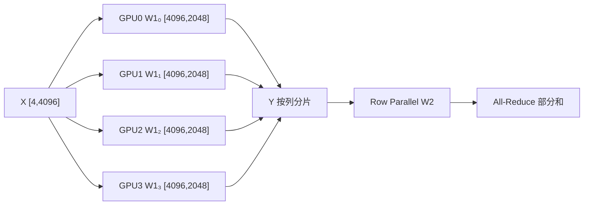

# 为什么 TP 能省显存，却可能让模型变慢？

假设输入 X=[4,4096]，MLP 两个权重 W1=[4096,8192]、W2=[8192,4096]，BF16，TP=4。W1、W2 各 64 MiB；单卡保存两者共 128 MiB。TP=4 后两者合计约 32 MiB/卡（仅权重）。

## 一个必须先澄清的判断：并行是加速还是减速？

**两种比较基线不能混用。** 对同一个固定工作负载，假设单 GPU 可以运行，理想 TP=p 时计算工作量均摊，单卡关键路径中的计算项可能从 `T_compute(1)` 降至近似 `T_compute(1)/p`；但会新增通信、启动、同步，并可能损失小 GEMM 的计算效率。因此

`T_TP(p) ≈ T_compute(1)/(p × η_kernel(p)) + T_collective(p) + T_sync(p)`

这里 `η_kernel` 是相对于理想分摊的有效算子效率因子，**并非恒等于 1**。TP 比单卡快的必要条件之一是节省的计算时间超过新增的通信、同步和算子效率损失。不能把 `FLOPs/p` 当作 `latency/p`。

如果**固定总 GPU 数、固定模型和总请求负载**，则比较对象通常是 `TP=1, DP=p` 与 `TP=p, DP=1`。前者让 p 个副本独立处理请求，后者让 p 张卡合作处理一个请求。在模型能放进单卡、请求足够多且显存/KV 都可行的情况下，TP 通常不会像增加独立副本那样提高整集群吞吐；通信反而可能拉低效率。相反，当模型单卡放不下，TP=1 根本不可行，不能拿不存在的单卡结果当实测加速基线。

| 假设场景（示意，不是实测） | 单 GPU / TP1 | TP4 的计算项 | TP4 额外开销 | TP4 总时间 | 结论 |
|---|---:|---:|---:|---:|---|
| 大 GEMM、计算密集 | 20 ms | 5 ms | 3 ms | 8 ms | 固定单请求延迟可能加速 |
| 小 Batch Decode | 2 ms | 0.5 ms | 2.5 ms | 3 ms | 单请求反而变慢 |
| 7B 权重超单卡容量 | 不可运行 | 依实际形状 | 必须测量 | 必须测量 | 主要收益是可运行 |

**吞吐、延迟、每卡效率、扩展效率是四个不同指标。** 固定单请求测 latency；固定总 GPU 和请求分布测 tokens/s；固定每 GPU 工作量测 weak scaling；固定总工作量测 strong scaling。TP/PP/EP/CP 的首要作用往往是突破容量约束，而不是保证性能加速。

## 从一个矩阵开始



**直觉**：W1 按列拆，每卡算不同输出列；W2 按输入行拆，每卡算相同输出位置的部分贡献。前者的输出可以保留分片，后者需要求和，不能把两种结果都当作拼接。

**不变量**：`concat(X@W1_i,-1)=X@W1`；`sum(Y_i@W2_i)=Y@W2`（浮点误差除外）。如果中间接逐元素激活函数，它可以在分片上独立执行；不能直接套用于所有跨维度算子。

## 计算、显存、通信

两个矩阵的总 FLOPs 约 `2 × 2 × 4 × 4096 × 8192 = 0.537 GFLOPs`；TP4 理想单卡约 0.134 GFLOPs。每个输出分片 `[4,2048]` 占 16 KiB；Row Parallel 输出 `[4,4096]` 占 32 KiB。以 Ring All-Reduce 近似，4 Rank 每卡传输 `2(4-1)/4 × 32 KiB = 48 KiB`；假设有效带宽 100 GB/s，纯带宽下界约 0.49 μs，不包含启动延迟和拓扑。在小 Batch Decode 中，启动延迟常常不能忽略。

训练的反向通信不能从前向的字节数直接猜出：复制输入布局下，Column Parallel 的输入梯度要在 TP 组内求和；Sequence Parallel 则把这次梯度归约与序列分片合在 Reduce-Scatter 中。二者应分别追踪 Forward 和 Backward。

## TP 与 SP 的 Forward/Backward 布局

前面的 `X=[4,4096]` 可以视为 Megatron Linear 常用的 `[S=4,B=1,H=4096]`，即 4 个序列位置、Batch=1。设 TP=4、BF16，第一层按输出列切成四个 `ColumnParallelLinear`，第二层按输入行切成四个 `RowParallelLinear`，中间只有逐元素激活。数学写法的 `W1=[4096,8192]`、`W2=[8192,4096]` 与 PyTorch 实际存储方向相反：各 Rank 参数 Shape 分别是 `[2048,4096]`、`[4096,2048]`。

不开 SP 时，每个 TP Rank 都持有完整 `X=[4,1,4096]`；Column GEMM 各自产生 `[4,1,2048]`。Row GEMM 的部分输出均是 `[4,1,4096]`，必须 All-Reduce 求和。反向时，Column GEMM 对复制输入的局部梯度也必须求和，否则每个 Rank 只得到部分 `dX`。开启 SP 后，保留完整序列的时机发生变化：

| 对象与阶段 | TP=4、SP 关闭 | TP=4、SP 开启 |
|---|---|---|
| Column Forward 输入 | `[4,1,4096]`，各 Rank 复制 | `[1,1,4096]` 序列分片，经 All-Gather 展开为 `[4,1,4096]` |
| Column 输出 / Row 输入 | 每 Rank `[4,1,2048]` | 每 Rank `[4,1,2048]` |
| Row Forward 输出 | 局部 `[4,1,4096]`，All-Reduce 后每卡完整 | 局部 `[4,1,4096]`，Reduce-Scatter 后每卡 `[1,1,4096]` |
| Row Backward 接收的输出梯度 | 各 Rank 完整 `[4,1,4096]` | 由 `[1,1,4096]` All-Gather 为 `[4,1,4096]` |
| Column Backward 的输入梯度 | 局部贡献 All-Reduce，得到完整 `[4,1,4096]` | 局部贡献 Reduce-Scatter，得到 `[1,1,4096]` |

**不变量是梯度之和，不是分片数量。** 取一个两维的极小反例：`x=[1,2]`，两层权重均为单位矩阵，两个 Rank 各保留一个中间维度，`L=0.5*sum(z²)=2.5`。完整的 `dL/dx=[1,2]`；两张卡只做各自的 Backward 时，得到的局部贡献分别为 `[1,0]` 和 `[0,2]`，缺少求和就会把本地部分梯度误当成完整梯度。此处是精确的代数演示，不是 GPU 实测。

```python
import torch

x = torch.tensor([[1.0, 2.0]])
w1 = w2 = torch.eye(2)
z = (x @ w1) @ w2
dz = z  # L = 0.5 * (z ** 2).sum()
partial_dx = [(dz @ w2[i:i+1, :].T) @ w1[:, i:i+1].T for i in range(2)]
assert [p.tolist() for p in partial_dx] == [[[1.0, 0.0]], [[0.0, 2.0]]]
assert sum(partial_dx).tolist() == [[1.0, 2.0]]
```

### 用通信字节检查是否真的省了带宽

该锚点的完整输入/输出张量 `[4,1,4096]` 是 `4×1×4096×2=32 KiB`。在理想 Ring 近似下，TP4 的一次 All-Reduce 每 Rank 发送 `2×(4−1)/4×32=48 KiB`；一次 All-Gather 或 Reduce-Scatter 发送 `(4−1)/4×32=24 KiB`。只计上述 MLP 边界（不计参数梯度的 DP 通信、额外缓存和其它算子）：

| 通信方案 | Forward | Backward | Ring 估算总发送量 / Rank |
|---|---|---|---:|
| 不开 SP | Row 输出 All-Reduce：48 KiB | Column 输入梯度 All-Reduce：48 KiB | **96 KiB** |
| 开启 SP | Column 输入 All-Gather + Row 输出 Reduce-Scatter：48 KiB | Row 输出梯度 All-Gather + Column 输入梯度 Reduce-Scatter：48 KiB | **96 KiB** |

这个例子中，SP 并没有减少这两段通信的总字节，却把非算子边界的 `[4,1,4096]` 激活复制改成了每 Rank `[1,1,4096]`，即 **32 KiB → 8 KiB**。代价是 Collective 从 2 次变为 4 次；是否更快取决于算子 Shape、启动延迟、通信与计算重叠及更大模型中的激活存活时段，不能由字节相同直接推断相同延迟。Ring 字节是算法假设，非已测量网络流量。

### 对照 Megatron Core 的实际路径

已核对 NVIDIA/Megatron-LM 的 [固定提交 `f677840c` 中 `tensor_parallel/layers.py`](https://github.com/NVIDIA/Megatron-LM/blob/f677840c61068c33409a5da1756a5ae3c9cd4791/megatron/core/tensor_parallel/layers.py) 与 [`tensor_parallel/mappings.py`](https://github.com/NVIDIA/Megatron-LM/blob/f677840c61068c33409a5da1756a5ae3c9cd4791/megatron/core/tensor_parallel/mappings.py)：`ColumnParallelLinear` 的常规输入梯度路径使用 All-Reduce，`sequence_parallel=True` 时通过 Reduce-Scatter 返回序列分片；`RowParallelLinear` 的普通 Forward 采用 `reduce_from_tensor_model_parallel_region`，SP 路径采用 `reduce_scatter_to_sequence_parallel_region`，后者的 Backward 对应 All-Gather。`gather_output`、`input_is_parallel`、Expert 特殊路径和推理优化分支会改变实际操作，不能将此表推广到所有配置。

最小核查是固定单卡参考权重、`[S,B,H]` 和 Loss Reduction，分别运行 TP4、TP4+SP，在各 Rank 记录 `ColumnParallelLinear`、`RowParallelLinear` 的输入/输出与 `dX` Shape，打印 TP Process Group 并与单卡梯度比较；再从 Nsight Timeline 数出上述 Collective。若输出接近但 `dX` 只剩各自的部分贡献，优先检查 Copy/Reduce 的反向映射和 SP 的分片边界，而不是修改学习率。本文的 Shape/字节已按公式复算，上述多 GPU 试验尚未执行。

## 源码与排障

Megatron Core 的 `ColumnParallelLinear`、`RowParallelLinear` 是合适的阅读入口；查看 TP Process Group、输入/输出分片约定和 Forward/Backward Collective。先用单卡参考值验证 `max_abs_error`，再用 Nsight Systems 看 GEMM 与 NCCL 的关键路径。

| 对象 | TP4 形状 | 在哪里计算 | 要记录什么 |
|---|---|---|---|
| W1_i | [4096,2048] | Column GEMM | 参数字节、Kernel 时间 |
| Y_i | [4,2048] | Column 输出 | 分片维度、是否 Gather |
| W2_i | [2048,4096] | Row GEMM | 乘法耗时 |
| Z_i | [4,4096] | Row 局部输出 | All-Reduce bytes、耗时 |

排障路径：**TP 增大但变慢** → 比较单卡 GEMM 减少量与 NCCL 增加量 → 区分节点内/跨节点 → 检查小 Batch 启动延迟；**结果错误** → 先查切分轴、Bias、激活函数及输出布局；**OOM** → 区分权重、激活、临时缓冲和训练优化器状态。

**最小实验**：固定 X、W、随机种子，分别 TP=1/2/4，比较输出、每卡显存和 Trace；不要直接用单次吞吐得出最优 TP。

**交互图规格**：GPU 数量 1/2/4/8 为唯一主控制；矩阵按列等宽分片并同步更新局部 Shape、权重 MiB；切换 Column→Row 时，动画从“拼接”变成“部分和归约”。明确展示逻辑结果与实际通信的区别。适合在独立站点实现，正文不依赖交互才能理解。

参考：[Megatron Core](https://docs.nvidia.com/megatron-core/developer-guide/latest/index.html)。
