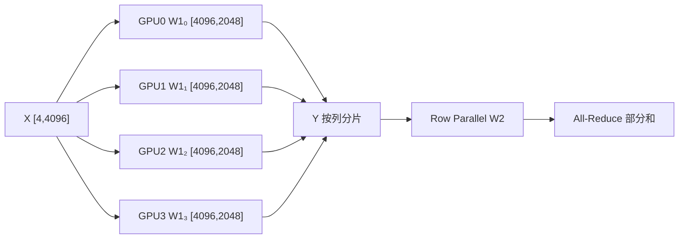

# 为什么 TP 能省显存，却可能让模型变慢？

假设输入 X=[4,4096]，MLP 两个权重 W1=[4096,8192]、W2=[8192,4096]，BF16，TP=4。W1、W2 各 64 MiB；单卡保存两者共 128 MiB。TP=4 后两者合计约 32 MiB/卡（仅权重）。

## 一个必须先澄清的判断：并行是加速还是减速？

**两种比较基线不能混用。** 对同一个固定工作负载，假设单 GPU 可以运行，理想 TP=p 时计算工作量均摊，单卡关键路径中的计算项可能从 `T_compute(1)` 降至近似 `T_compute(1)/p`；但会新增通信、启动、同步，并可能损失小 GEMM 的计算效率。因此

`T_TP(p) ≈ T_compute(1)/(p × η_kernel(p)) + T_collective(p) + T_sync(p)`

这里 `η_kernel` 是相对于理想分摊的有效算子效率因子，**并非恒等于 1**。TP 比单卡快的必要条件之一是节省的计算时间超过新增的通信、同步和算子效率损失。不能把 `FLOPs/p` 当作 `latency/p`。

如果**固定总 GPU 数、固定模型和总请求负载**，则比较对象通常是 `TP=1, DP=p` 与 `TP=p, DP=1`。前者让 p 个副本独立处理请求，后者让 p 张卡合作处理一个请求。在模型能放进单卡、请求足够多且显存/KV 都可行的情况下，TP 通常不会像增加独立副本那样提高整集群吞吐；通信反而可能拉低效率。相反，当模型单卡放不下，TP=1 根本不可行，不能拿不存在的单卡结果当实测加速基线。

| 假设场景（示意，不是实测） | 单 GPU / TP1 | TP4 的计算项 | TP4 额外开销 | TP4 总时间 | 结论 |
|---|---:|---:|---:|---:|---|
| 大 GEMM、计算密集 | 20 ms | 5 ms | 3 ms | 8 ms | 固定单请求延迟可能加速 |
| 小 Batch Decode | 2 ms | 0.5 ms | 2.5 ms | 3 ms | 单请求反而变慢 |
| 7B 权重超单卡容量 | 不可运行 | 依实际形状 | 必须测量 | 必须测量 | 主要收益是可运行 |

**吞吐、延迟、每卡效率、扩展效率是四个不同指标。** 固定单请求测 latency；固定总 GPU 和请求分布测 tokens/s；固定每 GPU 工作量测 weak scaling；固定总工作量测 strong scaling。TP/PP/EP/CP 的首要作用往往是突破容量约束，而不是保证性能加速。

## 从一个矩阵开始

**直觉**：W1 按列拆，每卡算不同输出列；W2 按输入行拆，每卡算相同输出位置的部分贡献。前者的输出可以保留分片，后者需要求和，不能把两种结果都当作拼接。

**不变量**：`concat(X@W1_i,-1)=X@W1`；`sum(Y_i@W2_i)=Y@W2`（浮点误差除外）。如果中间接逐元素激活函数，它可以在分片上独立执行；不能直接套用于所有跨维度算子。

## 计算、显存、通信

两个矩阵的总 FLOPs 约 `2 × 2 × 4 × 4096 × 8192 = 0.537 GFLOPs`；TP4 理想单卡约 0.134 GFLOPs。每个输出分片 `[4,2048]` 占 16 KiB；Row Parallel 输出 `[4,4096]` 占 32 KiB。以 Ring All-Reduce 近似，4 Rank 每卡传输 `2(4-1)/4 × 32 KiB = 48 KiB`；假设有效带宽 100 GB/s，纯带宽下界约 0.49 μs，不包含启动延迟和拓扑。在小 Batch Decode 中，启动延迟常常不能忽略。

训练的反向通信也要计算：Column Parallel 的输入梯度需要跨 TP Rank 求和；Row Parallel 的输出梯度会按其布局分发。具体是否采用 Reduce-Scatter / All-Gather 取决于 Sequence Parallel 与实现路径。

## 源码与排障

Megatron Core 的 `ColumnParallelLinear`、`RowParallelLinear` 是合适的阅读入口；查看 TP Process Group、输入/输出分片约定和 Forward/Backward Collective。先用单卡参考值验证 `max_abs_error`，再用 Nsight Systems 看 GEMM 与 NCCL 的关键路径。

| 对象 | TP4 形状 | 在哪里计算 | 要记录什么 |
|---|---|---|---|
| W1_i | [4096,2048] | Column GEMM | 参数字节、Kernel 时间 |
| Y_i | [4,2048] | Column 输出 | 分片维度、是否 Gather |
| W2_i | [2048,4096] | Row GEMM | 乘法耗时 |
| Z_i | [4,4096] | Row 局部输出 | All-Reduce bytes、耗时 |

排障路径：**TP 增大但变慢** → 比较单卡 GEMM 减少量与 NCCL 增加量 → 区分节点内/跨节点 → 检查小 Batch 启动延迟；**结果错误** → 先查切分轴、Bias、激活函数及输出布局；**OOM** → 区分权重、激活、临时缓冲和训练优化器状态。

**最小实验**：固定 X、W、随机种子，分别 TP=1/2/4，比较输出、每卡显存和 Trace；不要直接用单次吞吐得出最优 TP。

**交互图规格**：GPU 数量 1/2/4/8 为唯一主控制；矩阵按列等宽分片并同步更新局部 Shape、权重 MiB；切换 Column→Row 时，动画从“拼接”变成“部分和归约”。明确展示逻辑结果与实际通信的区别。适合在独立站点实现，正文不依赖交互才能理解。

参考：[Megatron Core](https://docs.nvidia.com/megatron-core/developer-guide/latest/index.html)。
