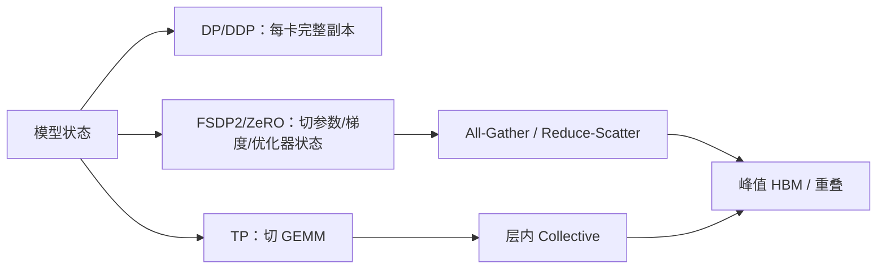

# FSDP2、ZeRO、Megatron TP：到底是在切什么？

模型放不下时，第一反应往往是加 TP。但“切计算”与“切状态”是不同决策。前者减少单卡算子工作量，后者减少参数/梯度/优化器状态常驻量；两者可以组合。

## 8 GPU、7B 参数的粗估

设参数 7×10⁹，BF16 权重 2 B/param、BF16 梯度 2 B/param、Adam FP32 两个 Moment 8 B/param，另有 FP32 Master Weight 4 B/param（**此项取决于实现，不能默认都有**）。合计约 16 B/param，即约 112 GB 十进制字节；不含 Activation、通信 Buffer、Allocator、Embedding 特殊处理。若无 Master Weight 则约 84 GB。理想状态均分到 8 Rank，分别约 14 GB 或 10.5 GB/卡；**这是常驻状态的理想分片，不是 Peak HBM**。

## 三类状态生命周期

**DDP**：每个 Rank 保留完整模型与优化器状态，梯度通过 All-Reduce 同步；并行增加有效 Batch/吞吐能力，但单副本模型仍要放得下。

**FSDP2**：在模块粒度将参数表示为 DTensor 分片；计算前 All-Gather 获得所需完整参数视图，反向归约梯度后可 Reduce-Scatter。峰值取决于模块粒度、预取、Reshard、Activation 和通信重叠；`fully_shard` 的调用位置影响显存曲线。

**ZeRO**：通常按 Stage 区分分片范围：Stage 1 分片 Optimizer State，Stage 2 进一步分片 Gradient，Stage 3 进一步分片 Parameter。具体 Buffer、Offload 与实现版本影响性能，不能把 Stage 3 与所有 FSDP2 策略视为完全相同。

**TP**：对 Linear/Attention 算子内部矩阵分片，减少每卡权重和计算；即使 TP=8，仍可能需要 DP 组的梯度同步、优化器分片和激活重计算。

## 实际选型

| 目标 | 首先考虑 | 代价 |
|---|---|---|
| 单卡状态 OOM，算子本身可运行 | FSDP2 / ZeRO | All-Gather/Reshard 峰值与通信 |
| 单个算子太大或计算需多卡 | TP | 层内 Collective、拓扑约束 |
| 模型层数很深 | PP | Bubble、Stage 不均衡 |
| MoE Expert 参数规模大 | EP | Token All-to-All、热点 Expert |
| 超长上下文 | CP / SP + 重计算 | KV/激活通信 |

**代码映射**：PyTorch `fully_shard` / DeviceMesh；DeepSpeed ZeRO 配置；Megatron Core TP/PP/EP/CP；观察各组 Rank、模块边界、Optimizer State dtype、All-Gather/Reduce-Scatter Timeline。不要只读配置名，要在 Trace 中确认实际执行。

**排障**：FSDP OOM → 抓 Forward All-Gather 峰值、Prefetch 与 Activation；TP 加大反而慢 → 对照 GEMM 与 NCCL；梯度不一致 → 核对 Loss Reduction、Accumulation、DP Group 和分片归约语义。

三个实验：同一模型固定有效 Batch，DDP/FSDP2 对照 HBM；切换 FSDP Wrap 粒度观察峰值；TP1/2/4 对照计算与通信。若设备不足，只做理论上界，不填造实测结果。

参考：[PyTorch FSDP2](https://docs.pytorch.org/docs/stable/distributed.fsdp.fully_shard.html)、[DeepSpeed ZeRO](https://www.deepspeed.ai/tutorials/zero/)。
